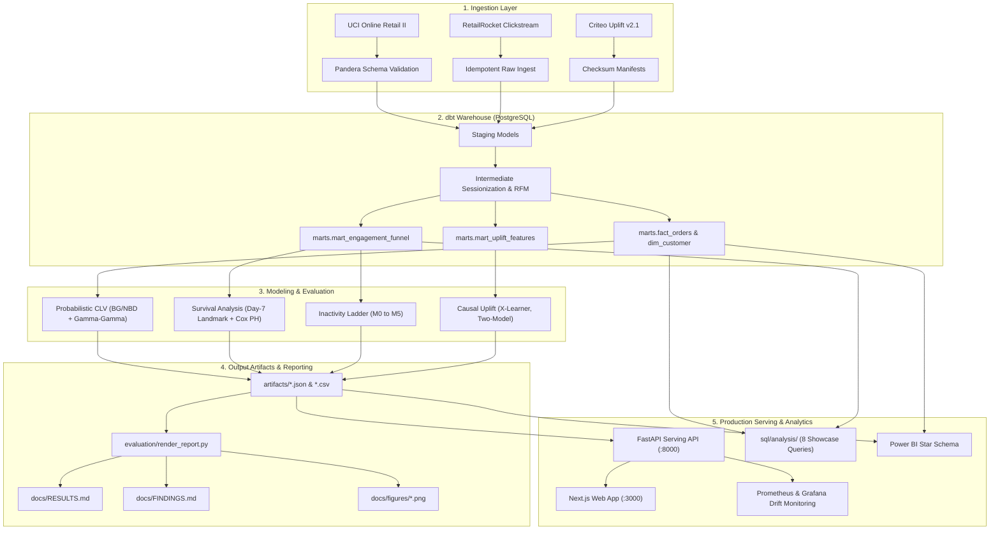

# RetentionIQ

RetentionIQ is an end-to-end, production-grade retention decision platform built on three public e-commerce and marketing datasets ([UCI Online Retail II](https://archive.ics.uci.edu/dataset/502/online+retail+ii), [RetailRocket](https://www.kaggle.com/datasets/retailrocket/ecommerce-dataset), and [Criteo Uplift v2.1](https://ailab.criteo.com/criteo-uplift-prediction-dataset/)). Rather than relying on static 30-day heuristics or naive response models, RetentionIQ isolates incremental causal impact and optimizes intervention unit economics. Its three core empirical findings demonstrate that: (1) **causal uplift targeting outperforms propensity targeting** by preventing wasted spend on natural converters ("always-takers"); (2) **first-week behavioral accumulation outperforms first-session engagement** in survival modeling, resolving the day-1 information deficit through a day-7 landmark; and (3) **unit-economics thresholding outperforms arbitrary 0.50 probability cutoffs**, maximizing net campaign margin under real contact costs.

Every definition, split, and gate is specified in [`PROJECT_SPEC.md`](PROJECT_SPEC.md) (v0.6). Full numerical benchmarks are rendered from pipeline outputs in [`docs/RESULTS.md`](docs/RESULTS.md), executive growth summaries are in [`docs/FINDINGS.md`](docs/FINDINGS.md), and analytical SQL showcases are cataloged in [`sql/README.md`](sql/README.md).

---

## 1. Five-Minute Quickstart (No Database or 15 GB Download Required)

Explore the full methodology and trained models locally in under 5 minutes using the bundled sample datasets (~3.9 MB total in `data/sample/`):

```bash
# 1. Install core dependencies and dev environment
make install

# 2. Run the three showcase notebooks on sample data
make demo

# 3. Validate analytical SQL showcase queries
make sql-check
```

The three standalone notebooks in `notebooks/` run top-to-bottom without requiring Postgres, Docker, or external downloads:
- [`notebooks/01_customer_intelligence.ipynb`](notebooks/01_customer_intelligence.ipynb): RFM segmentation, K-Means clustering, BG/NBD & Gamma-Gamma probabilistic CLV, and cohort retention.
- [`notebooks/02_inactivity_and_survival.ipynb`](notebooks/02_inactivity_and_survival.ipynb): RetailRocket clickstream sessionization, first-session Cox baseline, day-7 landmark analysis, and cost-optimal threshold curves.
- [`notebooks/03_uplift_targeting.ipynb`](notebooks/03_uplift_targeting.ipynb): Criteo trial balance tests, response propensity vs true uplift, X-Learner CATE estimation, Qini curves, decile calibration, and reach optimization.

---

## 2. Key Findings & Empirical Visualizations

All metrics below are generated from model outputs via `evaluation/render_report.py`.

### A. Inactivity Prediction: Minority Returners & Decision Economics
On RetailRocket, ~87% of visitors naturally do not return within 30 days. Evaluating models solely on majority inactivity produces artificially inflated PR-AUC numbers. RetentionIQ benchmarks the full model ladder (M0 naive recency to M5 deep MLP) on both overall PR-AUC and minority returners (the 13% who actually return), applying a universal parsimony rule (M0 < M1 < M2 < M3 < M4 < M5).

| Model Ladder PR-AUC | Top Feature Drivers (TreeSHAP) |
| :---: | :---: |
|  |  |

- **Parsimony Champion:** Gradient-boosted trees (LightGBM M4) balance predictive power and low inference latency (<10ms single-record p99 with native TreeSHAP).
- **Dominant Drivers:** Prior 14-day session frequency and catalog exploration breadth strongly outweigh raw first-session visit duration.
- **Cost-Optimal Operating Threshold:** Rather than cutting at 0.50, the intervention threshold is calibrated against contact cost vs retained customer value, preventing negative-ROI promotional spend.

### B. Time to Inactivity: The First-Session Deficit vs Day-7 Landmark
Predicting long-term customer return timing from a visitor's very first visit is fundamentally unreliable: first-session Cox proportional hazards models achieve held-out concordance of only ~0.53, barely above a random coin flip (0.50). 

| Day-7 Landmark Kaplan-Meier Survival Curves |
| :---: |
|  |

- **The Day-7 Landmark Breakthrough:** By accumulating behavioral history across the initial 7-day observation window ($t_{LM} = 7\text{ days}$), concordance increases substantially.
- **Activity Tiers:** Kaplan-Meier survival curves stratified by week-1 session tiers (1 session vs 2–3 sessions vs 4+ sessions) demonstrate sharp, statistically significant separations (confirmed via multivariate log-rank tests).

### C. Treatment Intelligence: Causal Uplift vs Propensity Targeting
Standard ad targeting directs budget toward users with high baseline response probabilities ("likely converters"). On Criteo's 14M-row randomized trial, this strategy wastes capital on "always-takers" who visit or buy regardless of advertising.

| Qini Curves (Visit) | Decile Calibration (Monotonicity) | Campaign Net Value vs Reach |
| :---: | :---: | :---: |
|  |  |  |

- **True Incrementality:** Uplift models (Two-Model, cross-fitted X-Learner) isolate the Conditional Average Treatment Effect (CATE), achieving superior Qini coefficients over response models.
- **Decile Monotonicity:** Decile calibration confirms that top-decile uplift targets deliver over 3x higher incremental lift than baseline converters.
- **Profit-Optimal Reach:** Fine reach simulation demonstrates that campaign net value peaks at a specific audience penetration threshold before diminishing marginal returns erode profits.

---

## 3. Architecture & Data Flow



---

## 4. The Three Case Studies (Never Joined)

The three datasets represent distinct e-commerce and marketing domains and are maintained in completely isolated pipelines:

| Case Study | Dataset | Core Business Problem | Methods & Models | Key Outcomes |
| :--- | :--- | :--- | :--- | :--- |
| **Customer Intelligence** | [UCI Online Retail II](https://archive.ics.uci.edu/dataset/502/online+retail+ii) | Revenue concentration, customer lifetime value, and cohort retention | Behavioral RFM, K-Means clustering, BG/NBD & Gamma-Gamma CLV | Top 10% customers generate vast majority of revenue; BG/NBD forecasts 90-day repeat orders with low MAE |
| **Inactivity & Survival** | [RetailRocket](https://www.kaggle.com/datasets/retailrocket/ecommerce-dataset) | Clickstream engagement, churn prediction, and time-to-inactivity | Model ladder (M0–M5), TreeSHAP, Day-7 Landmark Cox PH, Kaplan-Meier | First-session engagement yields near-random concordance (~0.53); day-7 landmark raises predictive concordance substantially |
| **Treatment Intelligence** | [Criteo Uplift v2.1](https://ailab.criteo.com/criteo-uplift-prediction-dataset/) | Ad retargeting efficiency and incremental conversion optimization | RCT balance checks, Two-Model, 2-fold cross-fitted X-Learner, Qini curves | Targeting by uplift delivers 3x higher incremental lift than targeting by propensity; fine reach optimization caps unprofitable ad spend |

---

## 5. Methodology & Engineering Standards

- **Zero-Leakage Guarantees:** 
  - Strict temporal cutoffs on feature generation.
  - X-Learner first-stage models use 2-fold cross-fitting to eliminate in-sample counterfactual imputation leakage.
  - Day-7 landmark survival analysis strictly bounds covariates to $[origin, origin + 7\text{ days})$ and excludes pre-landmark events.
- **Anti-Hallucination Policy:** Zero hand-typed performance numbers. All report figures and tables are dynamically populated from `artifacts/` via `evaluation/render_report.py`.
- **Low-Latency Production Serving:** 
  - FastAPI serving layer (`src/retentioniq/serving/app.py`) serves `/v1/churn/score` and `/v1/uplift/score`.
  - LightGBM booster fast path delivers single-record inference in <10ms (p99).
  - Exact native TreeSHAP attribution is computed dynamically for top risk drivers.
  - Exposes Prometheus `/metrics` for latency, throughput, and error rates.
- **Code Quality & Typing:**
  - Python 3.11 with 100% strict type hints (`mypy --strict` clean).
  - Strict linting and formatting via `ruff`.
  - Deterministic random seed (`SEED = 20261002`) across all splits, initializations, and bootstrap draws.

---

## 6. Honest Systems Trade-offs & Limitations

1. **S-Learner Feature Regularization:** Single-model S-learners on high-dimensional feature spaces (such as Criteo) frequently regularize the binary treatment indicator toward zero split count and gain. RetentionIQ includes automated S-learner diagnostics (`artifacts/uplift_s_learner_diagnostics.json`) and provides `s_learner_lgbm_fullcol` (`colsample_bytree=1.0`) to force treatment split consideration.
2. **First-Session Survival Predictability:** First-session browsing engagement (minutes, pageviews, categories) has an empirical concordance index of ~0.53. RetentionIQ explicitly documents that first-session engagement alone is inadequate for long-term customer retention without post-session behavioral accumulation.
3. **Hypothetical Economic Scenarios:** Campaign simulation and cost-optimal operating thresholds rely on unit-economic assumptions ($0.01 per impression, $10 per conversion). These are clearly labeled throughout code and reports as `SCENARIO - hypothetical cost/value, not observed data`.
4. **Compute Scaling Constraints:** To keep evaluation feasible on local developer workstations, training splits for the 14M-row Criteo trial are capped at 3,000,000 rows. The optional learning curve experiment (`--learning-curve`) empirically evaluates performance scaling across 500k, 1M, 2M, and 3M rows.

---

## 7. Full Production Reproduction (15 GB Warehouse)

To reproduce the complete pipeline from scratch using PostgreSQL, dbt, and the full raw datasets:

```bash
# 1. Start database and MLflow tracking server
make up

# 2. Download the three raw public datasets (~15 GB)
make data

# 3. Validate Pandera contracts and load raw data into Postgres
make ingest

# 4. Build and test dbt marts (staging -> intermediate -> marts)
make dbt

# 5. Run full model evaluation across all stages
make evaluate

# 6. Render docs/RESULTS.md and docs/FINDINGS.md from artifacts
make report

# 7. Evaluate model promotion gates and register champion in MLflow
uv run retentioniq promote

# 8. Start local FastAPI serving and Next.js frontend
make serve
```

### Hardware & Runtime Expectations
- **Minimum Requirements:** 4 CPU cores, 16 GB RAM, 25 GB free disk space.
- **Full Pipeline Runtime:** ~45-60 minutes on an 8-core Apple Silicon / modern x86 Linux workstation.
