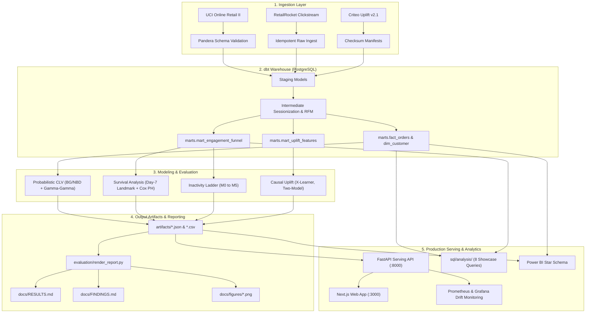

# RetentionIQ

RetentionIQ is an end-to-end, production-grade retention decision platform built on three public e-commerce and marketing datasets ([UCI Online Retail II](https://archive.ics.uci.edu/dataset/502/online+retail+ii), [RetailRocket](https://www.kaggle.com/datasets/retailrocket/ecommerce-dataset), and [Criteo Uplift v2.1](https://ailab.criteo.com/criteo-uplift-prediction-dataset/)). Rather than relying on static 30-day heuristics or naive response models, RetentionIQ isolates incremental causal impact and optimizes intervention unit economics. It is built to test three core claims: (1) **causal uplift targeting outperforms propensity targeting** by preventing wasted spend on natural converters ("always-takers"); (2) **first-week behavioral accumulation outperforms first-session engagement** in survival modeling, resolving the day-1 information deficit through a day-7 landmark; and (3) **unit-economics thresholding outperforms arbitrary 0.50 probability cutoffs**, maximizing net campaign margin under real contact costs.

Every definition, split, and gate is specified in [`PROJECT_SPEC.md`](PROJECT_SPEC.md) (v0.6). Full numerical benchmarks are rendered from pipeline outputs in [`docs/RESULTS.md`](docs/RESULTS.md), executive growth summaries are in [`docs/FINDINGS.md`](docs/FINDINGS.md), and analytical SQL showcases are cataloged in [`sql/README.md`](sql/README.md).

---

## 1. Five-Minute Quickstart (No Database or 15 GB Download Required)

Explore the full methodology and trained models locally in under 5 minutes using the bundled **synthetic** sample datasets (~3.9 MB total in `data/sample/`). They are generated with a seeded random generator by `scripts/make_sample.py` to mimic the real schemas; they are **not** drawn from the real datasets, so notebook outputs demonstrate the method, not real findings:

```bash
# 1. Install core dependencies and dev environment
make install

# 2. Run the three showcase notebooks on sample data
make demo

# 3. Validate analytical SQL showcase queries
make sql-check
```

The three standalone notebooks in `notebooks/` run top-to-bottom without requiring Postgres, Docker, or external downloads:
- [`notebooks/01_customer_intelligence.ipynb`](notebooks/01_customer_intelligence.ipynb): RFM segmentation, K-Means clustering, BG/NBD & Gamma-Gamma probabilistic CLV, and cohort retention.
- [`notebooks/02_inactivity_and_survival.ipynb`](notebooks/02_inactivity_and_survival.ipynb): RetailRocket clickstream sessionization, first-session Cox baseline, day-7 landmark analysis, and cost-optimal threshold curves.
- [`notebooks/03_uplift_targeting.ipynb`](notebooks/03_uplift_targeting.ipynb): Criteo trial balance tests, response propensity vs true uplift, X-Learner CATE estimation, Qini curves, decile calibration, and reach optimization.

---

## 2. Key Findings & Empirical Visualizations

> **Results status (2026-11-10).** The v0.6 code (parsimony rule, cross-fitted X-learner, day-7
> landmark survival, CLV) is implemented and unit-tested, but **has not yet been run on the real
> datasets**, so `artifacts/` is empty and the v0.6 figures do not exist yet. The numbers below are
> from the **last verified full run (spec v0.5, git `bcce5ce`)**; read that report with
> `git show 1a8b06b:docs/RESULTS.md`. Claims marked *pending* need `make reproduce`. After a run,
> `make report` regenerates [`docs/RESULTS.md`](docs/RESULTS.md),
> [`docs/FINDINGS.md`](docs/FINDINGS.md) and `docs/figures/` strictly from `artifacts/`.

### A. Inactivity Prediction: Minority Returners & Decision Economics
In the v0.5 test snapshot, 87.4% of RetailRocket visitors did not return within the 30-day prediction window, so PR-AUC on the inactive class starts near 0.87 for a random score. RetentionIQ benchmarks the full model ladder (M0 naive recency to M5 MLP) on overall PR-AUC and on the minority who return, and v0.6 applies a parsimony rule (pick the simplest model statistically tied with the best).

- **Ladder (v0.5):** LightGBM M4 test PR-AUC 0.952 [0.949, 0.955] vs 0.930 for naive recency. M2 logistic, M3 random forest and M5 MLP were within ~0.003 of M4, so the v0.6 parsimony rule may select a simpler champion (*pending*).
- **Drivers (v0.5, mean |SHAP|):** `recency_vs_typical_gap`, `recency_days` and `tenure_days`; the temporal feature family gave the largest ablation gain (+0.008 PR-AUC).
- **Operating threshold:** chosen from contact cost vs value of a retained visitor instead of a fixed 0.50 cutoff. The economics are a labeled *hypothetical scenario*, not observed data.

### B. Time to Inactivity: First Session vs Day-7 Landmark
- **First session (v0.5):** a Cox model on first-session covariates reached held-out concordance of **0.507**, essentially random (0.50).
- **Day-7 landmark (v0.6, *pending*):** tests whether one week of accumulated behavior (sessions, active days, catalog breadth) ranks return timing better, with Kaplan-Meier curves and a log-rank test across week-1 activity tiers. No result has been produced yet.

### C. Treatment Intelligence: Causal Uplift vs Propensity Targeting
Targeting the users most likely to convert spends budget on people who would have converted anyway. Criteo's 14M-row randomized trial lets us measure incremental effect directly.

- **Average effect (v0.5):** treatment raised visits by +1.03 pp (+27% relative) and conversions by +0.115 pp (+59%); covariate balance max |SMD| 0.049.
- **Uplift vs propensity (v0.5):** the strategy selected on validation Qini, an S-learner (LightGBM), beat the response model on test Qini for visits (0.092 vs 0.087). Not every uplift learner did: the X-learner (0.085) and T-learner (0.077) scored below the response model. v0.6 cross-fits the X-learner (*pending*).
- **Reach (v0.5):** at 1% reach the S-learner produced ~2.9x the incremental *visits* of the response model, but not more incremental *conversions* (1,050 vs 1,169, overlapping CIs).
- **Profit-optimal reach:** computed under hypothetical cost/value assumptions (*scenario*, *pending* for v0.6).

---

## 3. Architecture & Data Flow



---

## 4. The Three Case Studies (Never Joined)

The three datasets represent distinct e-commerce and marketing domains and are maintained in completely isolated pipelines:

| Case Study | Dataset | Core Business Problem | Methods & Models | Key Outcomes |
| :--- | :--- | :--- | :--- | :--- |
| **Customer Intelligence** | [UCI Online Retail II](https://archive.ics.uci.edu/dataset/502/online+retail+ii) | Revenue concentration, customer lifetime value, and cohort retention | Behavioral RFM, K-Means clustering, BG/NBD & Gamma-Gamma CLV | Top 10% customers generate vast majority of revenue; BG/NBD forecasts 90-day repeat orders with low MAE |
| **Inactivity & Survival** | [RetailRocket](https://www.kaggle.com/datasets/retailrocket/ecommerce-dataset) | Clickstream engagement, churn prediction, and time-to-inactivity | Model ladder (M0–M5), TreeSHAP, Day-7 Landmark Cox PH, Kaplan-Meier | v0.5: first-session Cox concordance 0.507 (near random); day-7 landmark result pending |
| **Treatment Intelligence** | [Criteo Uplift v2.1](https://ailab.criteo.com/criteo-uplift-prediction-dataset/) | Ad retargeting efficiency and incremental conversion optimization | RCT balance checks, Two-Model, 2-fold cross-fitted X-Learner, Qini curves | v0.5: selected S-learner beats propensity on test Qini (0.092 vs 0.087); X/T-learners do not; reach economics are a hypothetical scenario |

---

## 5. Methodology & Engineering Standards

- **Zero-Leakage Guarantees:**
  - Strict temporal cutoffs on feature generation.
  - X-Learner first-stage models use 2-fold cross-fitting to eliminate in-sample counterfactual imputation leakage.
  - Day-7 landmark survival analysis strictly bounds covariates to $[origin, origin + 7\text{ days})$ and excludes pre-landmark events.
- **Anti-Hallucination Policy:** `docs/RESULTS.md`, `docs/FINDINGS.md` and `docs/figures/` are generated only from `artifacts/` by `evaluation/render_report.py`, which has no fallback values and refuses to run when `artifacts/` is empty. Numbers quoted in this README name the run (spec version, git SHA) they come from.
- **Low-Latency Production Serving:**
  - FastAPI serving layer (`src/retentioniq/serving/app.py`) serves `/v1/churn/predict`, `/v1/churn/batch` and `/v1/uplift/score`.
  - LightGBM booster fast path. v0.5 benchmark (4 CPU, local): single-record p99 2.7 ms at concurrency 1 and 50 ms at concurrency 8, within the spec §9.2 SLOs.
  - Exact native TreeSHAP attribution is computed dynamically for top risk drivers.
  - Exposes Prometheus `/metrics` for latency, throughput, and error rates.
- **Code Quality & Typing:**
  - Python 3.11 with 100% strict type hints (`mypy --strict` clean).
  - Strict linting and formatting via `ruff`.
  - Deterministic random seed (`SEED = 20261002`) across all splits, initializations, and bootstrap draws.

---

## 6. Honest Systems Trade-offs & Limitations

1. **S-Learner Feature Regularization:** Single-model S-learners on high-dimensional feature spaces (such as Criteo) frequently regularize the binary treatment indicator toward zero split count and gain. RetentionIQ includes automated S-learner diagnostics (`artifacts/uplift_s_learner_diagnostics.json`) and provides `s_learner_lgbm_fullcol` (`colsample_bytree=1.0`) to force treatment split consideration.
2. **First-Session Survival Predictability:** First-session browsing engagement (minutes, pageviews, categories) had a held-out concordance index of 0.507 in the v0.5 run. RetentionIQ explicitly documents that first-session engagement alone is inadequate for long-term customer retention without post-session behavioral accumulation.
3. **Hypothetical Economic Scenarios:** Campaign simulation and cost-optimal operating thresholds rely on unit-economic assumptions ($0.01 per impression, $10 per conversion). These are clearly labeled throughout code and reports as `SCENARIO - hypothetical cost/value, not observed data`.
4. **Compute Scaling Constraints:** To keep evaluation feasible on local developer workstations, training splits for the 14M-row Criteo trial are capped at 3,000,000 rows. The optional learning curve experiment (`--learning-curve`) empirically evaluates performance scaling across 500k, 1M, 2M, and 3M rows.

---

## 7. Full Production Reproduction (15 GB Warehouse)

To reproduce the complete pipeline from scratch using PostgreSQL, dbt, and the full raw datasets:

```bash
# 1. Start database and MLflow tracking server
make up

# 2. Download the three raw public datasets (~15 GB)
make data

# 3. Validate Pandera contracts and load raw data into Postgres
make ingest

# 4. Build and test dbt marts (staging -> intermediate -> marts)
make dbt

# 5. Run full model evaluation across all stages
make evaluate

# 6. Render docs/RESULTS.md and docs/FINDINGS.md from artifacts
make report

# 7. Evaluate model promotion gates and register champion in MLflow
uv run retentioniq promote

# 8. Start local FastAPI serving and Next.js frontend
make serve
```

### Hardware & Runtime Expectations
- **Minimum Requirements:** 4 CPU cores, 16 GB RAM, 25 GB free disk space.
- **Full Pipeline Runtime:** ~45-60 minutes on an 8-core Apple Silicon / modern x86 Linux workstation.
