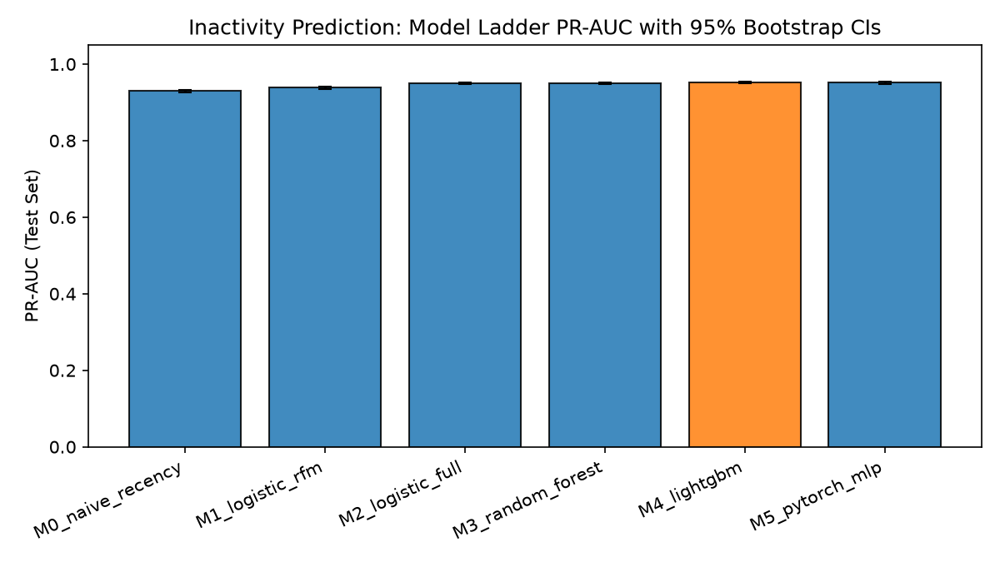
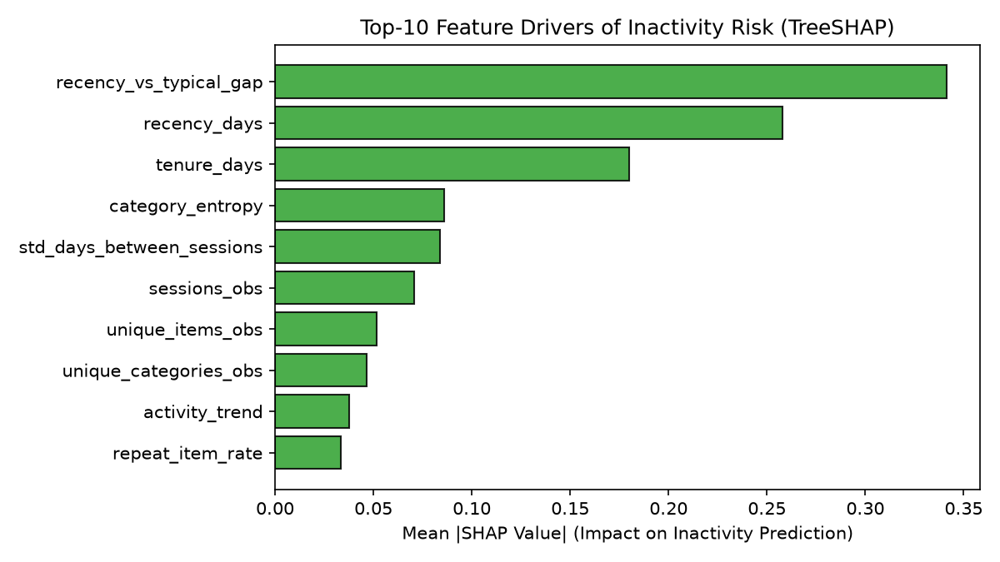
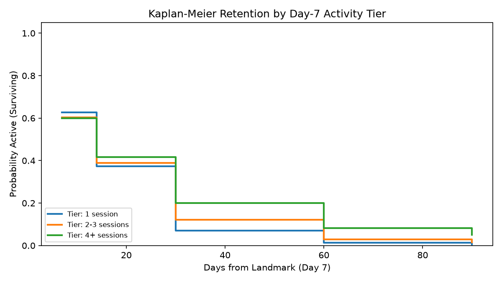
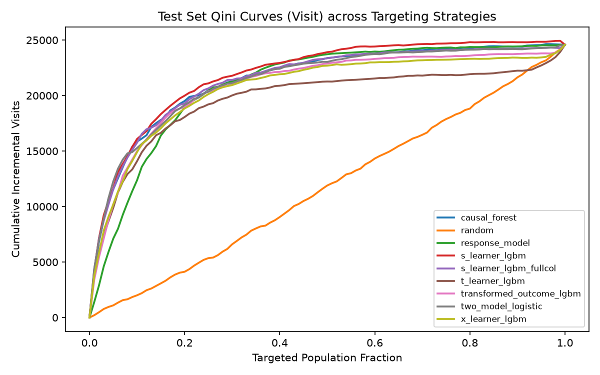
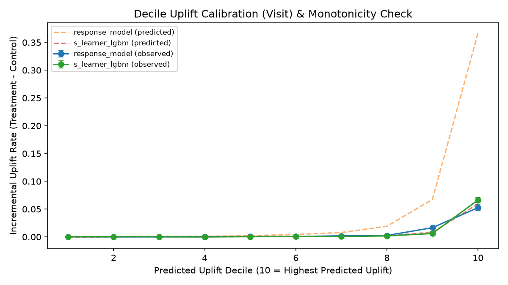
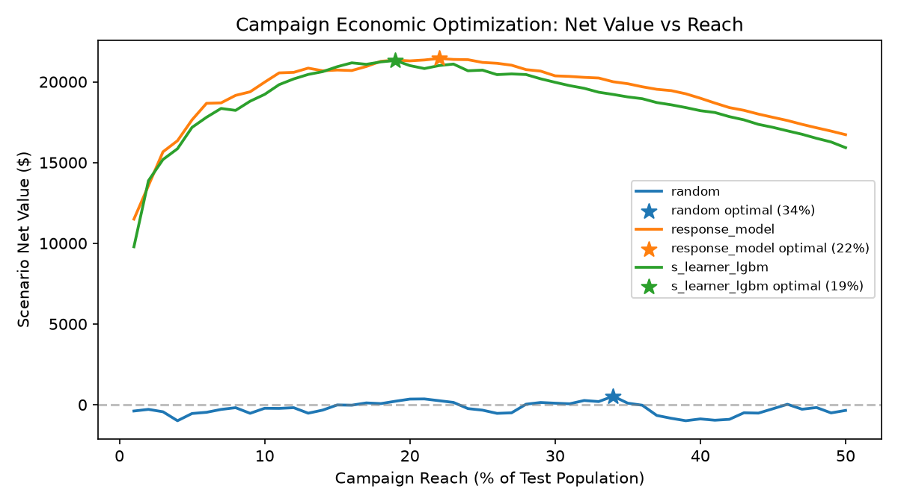
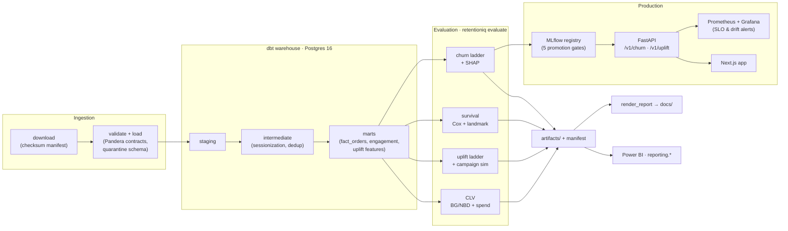

# RetentionIQ

**Retention decisions for e-commerce: who will lapse, who is worth keeping, and who a campaign actually moves.**

RetentionIQ answers three retention questions on three public datasets, end to end: from raw downloads to a dbt warehouse, model ladders with pre-registered evaluation, a gated model registry, and a monitored low-latency API.

| Question | Dataset | Approach | Answer on real data (spec v0.6) |
|---|---|---|---|
| Which visitors will go inactive? | [RetailRocket](https://www.kaggle.com/datasets/retailrocket/ecommerce-dataset) clickstream, 1.41M visitors | 6-model ladder (M0–M5), TreeSHAP, cost-based thresholds | LightGBM, PR-AUC **0.952** [0.949, 0.955] vs 0.930 naive recency |
| How much will each customer spend next quarter? | [UCI Online Retail II](https://archive.ics.uci.edu/dataset/502/online+retail+ii), 5,852 customers | BG/NBD + validity-gated spend model | Spearman **0.579** vs 0.525 naive for ranking 90-day spend |
| Whom should a campaign target? | [Criteo Uplift v2.1](https://huggingface.co/datasets/criteo/criteo-uplift), 13,979,592-row RCT | 8 targeting strategies, Qini, paired bootstrap | Uplift is **not** reliably better than propensity (see below) |

The project was built to test three claims. It reports what the data said, including where the claims failed:

1. **"Uplift targeting beats propensity targeting."** *Partly.* On visits, the selected S-learner's test Qini is higher (0.096 vs 0.086), but the paired-bootstrap difference is not significant (p = 0.096). On conversions, and on profit under the scenario economics, propensity wins.
2. **"A day-7 landmark beats first-session survival modeling."** *Refuted.* Held-out concordance is 0.506 vs 0.507.
3. **"Unit-economics thresholds beat a fixed 0.5 cutoff."** *Method only.* The cost-optimal threshold moves from 0.13 to 0.67 across 9 cost/value scenarios, but the economics are hypothetical, so no gain is measured.

> **Contents:** [Results](#results) · [How the evaluation is protected](#how-the-evaluation-is-protected) · [Architecture](#architecture) · [Production system](#production-system) · [Run it](#run-it) · [Repository map](#repository-map) · [Limitations](#limitations-and-open-issues)

---

## Results

All numbers come from one full run on the real datasets (spec v0.6, git `20f499a`, 4-core / 16 GB). Two stages were re-run after fixes: CLV under spec v0.6.1 (git `67d6365`), and churn + SHAP under spec v0.6.3 (git `f20edae`), with validation-only selection and a serving-latency gate. Every table and figure is rendered from `artifacts/` by `make report`: [`docs/RESULTS.md`](docs/RESULTS.md) has every table with confidence intervals, and [`docs/FINDINGS.md`](docs/FINDINGS.md) has the executive summary.

### 1. Inactivity prediction (RetailRocket)

**Label:** a visitor with ≥ 2 sessions in a 30-day observation window is *inactive* if they have no session in the next 30 days. **Splits:** rolling cutoffs (train: 3 weekly cutoffs, 105k rows; validation: 33.9k; test: 34.2k), separated in time so label windows never overlap.

87.4% of test visitors go inactive, so a random score already scores ≈ 0.874 PR-AUC. The ladder is judged against that floor and against a one-feature recency baseline:

| Model | Validation PR-AUC | Test PR-AUC [95% CI] | Brier | Scoring p95 |
|---|---|---|---|---|
| M0 naive recency | 0.9201 | 0.9300 [0.9268, 0.9334] | 0.1039 | 0.8 ms |
| M1 logistic on RFM | 0.9301 | 0.9384 [0.9352, 0.9418] | 0.0987 | 4.9 ms |
| M2 logistic, all 30 features | 0.9448 | 0.9496 [0.9468, 0.9528] | 0.0946 | 6.5 ms ✗ |
| M3 random forest | 0.9471 | 0.9498 [0.9470, 0.9526] | 0.0938 | 72.5 ms ✗ |
| **M4 LightGBM (champion)** | **0.9475** | **0.9521 [0.9493, 0.9550]** | **0.0933** | **0.08 ms** |
| M5 PyTorch MLP (6-config grid) | 0.9473 | 0.9514 [0.9487, 0.9545] | 0.0937 | 1.2 ms |

✗ = over the 5 ms single-record budget derived from the 200 req/s serving SLO, so not eligible as champion (spec §5.5).

| Model ladder | Drivers (mean \|SHAP\|) |
|:---:|:---:|
|  |  |

- **What the model adds:** most of the gain comes from moving to the full feature set (M1 → M2), not from model capacity. Nonlinear models add about 0.003 PR-AUC on top. The top drivers are `recency_vs_typical_gap`, `recency_days` and `tenure_days`.
- **Where it is useful:** among the 10% the model ranks most likely to *return*, the returner rate is 3.5× the base rate. That's the list a win-back team would actually work.
- **Selection (validation only):** M4 has the best validation PR-AUC, and every *eligible* simpler model (M0, M1) is significantly worse on validation, so M4 is champion. M3 random forest is statistically tied with M4 on validation, but serves at 72.5 ms p95, so it is not eligible.
- **Why the latency rule exists:** under spec v0.6.2 (validation-only selection, no latency check), M3 was selected and promoted. The API then served 28 req/s with p95 384 ms, against an SLO of 200 req/s and p95 100 ms. Spec v0.6.3 adds serving-cost eligibility and a latency promotion gate; the change log records that the rule was added after seeing that result.
- **Promotion:** M4 passed all 6 gates against the M1 reference: PR-AUC non-inferiority, Brier, per-segment degradation ≤ 0.03, dbt data validation, the schema contract and serving latency (0.08 ms p95 vs a 5 ms budget).

### 2. Time to inactivity (RetailRocket)

| Day-7 landmark Kaplan-Meier |
|:---:|
|  |

- **First-session Cox model:** held-out concordance **0.507**.
- **Day-7 landmark:** **0.506**, fitted on the 43,860 visitors still observable at day 7. Each week-1 covariate alone ranks at 0.499–0.510.
- **Activity tiers:** mean time to inactivity is 11.8 / 13.2 / 16.6 days for 1 / 2–3 / 4+ week-1 sessions (log-rank p ≈ 1e-75). Week-1 activity *does* shift the curves, but too little to rank individuals.
- **Takeaway:** timing of inactivity is not predictable from clickstream engagement on this data. The classifier above works because it sees a 30-day history, not just the first week.

### 3. Uplift targeting (Criteo randomized trial)

**ATE:** treatment raises visits by +1.03 pp (+27% relative) and conversions by +0.115 pp (+59%). Randomization balance check: max |SMD| is 0.049. Learners are selected on *validation* Qini (visit) and reported once on *test*.

| Strategy | Test Qini, visit | Test Qini, conversion | Uplift in top 1% (visit) |
|---|---|---|---|
| Response model (propensity) | 0.0864 | **0.1921** | 0.057 |
| **S-learner LightGBM (selected)** | **0.0958** | 0.1643 | 0.168 |
| Causal forest | 0.0911 | 0.1905 | 0.159 |
| Two-model logistic | 0.0896 | 0.1867 | 0.176 |
| X-learner (2-fold cross-fitted) | 0.0834 | 0.1320 | 0.151 |
| T-learner LightGBM | 0.0733 | 0.1268 | 0.151 |
| Random | −0.0054 | −0.0053 | 0.009 |

| Qini curves (visit) | Decile calibration (visit) | Net value vs reach |
|:---:|:---:|:---:|
|  |  |  |

- **Overall ranking:** the S-learner's visit-Qini lead over propensity is not significant (paired bootstrap p = 0.096). Only the causal forest is significantly better than propensity (p = 0.004).
- **Where uplift does differ:** at the very top of the ranking. In the top 1%, uplift learners find visitors whose treatment effect is about 3× what the response model's top 1% shows. Propensity catches up by 10–20% reach.
- **Profit (SCENARIO: $0.01 per impression, $10 per conversion):** propensity peaks at $22.9k net (22% reach) vs $21.1k for the S-learner (19% reach).
- **Recommendation:** for a broad campaign, propensity targeting is as good and much simpler. Uplift models only earn their cost when the budget covers a small top slice.

### 4. Customer value (Online Retail II)

The top 10% of customers generate 63.8% of revenue (Gini 0.74). CLV is calibrated through 2011-09-10 and evaluated on the next 90 days (5,256 customers):

| Model | Purchase MAE | Spearman (90-day spend) | Spend MAE |
|---|---|---|---|
| BG/NBD + empirical-Bayes spend | **0.694** | **0.579** | 376 |
| Naive historical rate | 0.701 | 0.525 | **367** |

- **Ranking:** the probabilistic model ranks future spend better. It's not more accurate in absolute dollars.
- **Spend model:** Gamma-Gamma fitted q = 0.34. With q ≤ 1 its population mean is undefined, so the pipeline falls back to an empirical-Bayes log-normal model, chosen by a rule on the fitted parameters, never by holdout score.
- **Aggregate revenue:** both models predict about two-thirds of holdout revenue. The window includes the Q4 peak and BG/NBD assumes stationary rates, so use it for **ranking**, not forecasting.

---

## How the evaluation is protected

The point of the project is that its numbers can be trusted, so the evaluation is designed against the usual ways ML results get inflated.

- **Pre-registration:**
  - Labels, splits, metrics, model ladders and selection rules are fixed in [`PROJECT_SPEC.md`](PROJECT_SPEC.md) before results exist.
  - Every change goes in a dated change log with its reason. One example: v0.4 caps uplift training at 3M rows for compute, decided before any uplift result.
- **Temporal correctness:**
  - Features use only events before each cutoff.
  - Label windows of train, validation and test never overlap.
  - Survival covariates come from the first session only (avoiding immortal-time bias), and landmark covariates come from [origin, origin + 7d).
- **Selection on validation, reporting on test:**
  - The churn champion is chosen by a validation-only rule (`models/churn/selection.py`); its signature accepts no test data, and a unit test pins that. Before spec v0.6.2 the rule's tie test used the test set, which is what had kept LightGBM as champion in v0.6.
  - Production constraints are part of selection, not an afterthought: a model must fit the 5 ms single-record budget, timed on the same function the API serves with (`models/churn/latency.py`).
  - Uplift learners are selected on validation Qini.
  - The X-learner's first stage is 2-fold cross-fitted, so counterfactuals are never imputed in-sample.
- **Uncertainty everywhere:** bootstrap CIs on every headline metric, plus paired bootstrap tests for model-vs-model claims. A difference is only called "better" when its CI excludes zero.
- **Generated reports:**
  - `RESULTS.md`, `FINDINGS.md` and the figures are rendered from `artifacts/` with no fallback values.
  - Directional words ("higher", "not significant") are computed, not typed.
  - The renderer refuses to run on an empty artifact set, and every stage records its spec version and git SHA in `artifacts/manifest.json`.
- **Scenario labeling:** anything that depends on assumed costs is labeled `SCENARIO` in code and reports.
- **Synthetic data quarantined:** the 3.9 MB samples in `data/sample/` are seeded synthetic data for the notebooks. They are labeled as such everywhere and never feed a reported number.

---

## Architecture



The three datasets are never joined. Each is its own case study with its own pipeline, because they come from different businesses.

---

## Production system

| Concern | Implementation |
|---|---|
| **Orchestration** | `make reproduce` locally. The Airflow DAG `retentioniq_training` runs weekly: `validate → transform → [train, analytics]`, then `train → explain → promote` |
| **Data quality** | Pandera contracts at ingest: rejected rows go to `quarantine.rejected_records`, and a file over its reject budget rolls back. `dbt build` runs 75 models and tests |
| **Experiment tracking** | MLflow (Postgres backend), with every ladder run logged |
| **Promotion** | `retentioniq promote` registers a challenger only if all 6 gates pass, including serving latency (spec §9.1); the decision is written to `artifacts/promotion_decision.json` |
| **Serving** | FastAPI with a LightGBM booster fast path and optional per-request TreeSHAP explanations |
| **Monitoring** | `retentioniq monitor`: feature and prediction PSI, missingness, ECE and freshness against the spec §9.3 thresholds. Prometheus scrapes `/metrics`; Grafana dashboard and alert rules are in `monitoring/` |
| **Deployment** | Terraform for AWS ECS Fargate behind an ALB, ECR, a versioned S3 raw bucket, and CloudWatch alarms → SNS ([`infrastructure/aws`](infrastructure/aws/README.md)). Definitions only; not deployed as part of the reported run |
| **BI** | `retentioniq publish` loads model outputs into Postgres `reporting.*`; `export-powerbi` writes a workbook for the Power BI service ([`analytics/powerbi`](analytics/powerbi/README.md)) |
| **CI** | GitHub Actions: ruff, mypy `--strict`, unit tests, integration tests, `dbt parse`, web typecheck/lint/build, SQL check and notebook execution |

### API

| Endpoint | Purpose |
|---|---|
| `POST /v1/churn/predict` | Score one visitor's feature vector; `?explain=true` adds the top SHAP drivers |
| `POST /v1/churn/batch` | Score many records |
| `GET /v1/churn/visitors[/{id}]` | Browse scored test-set visitors |
| `POST /v1/uplift/score` | CATE for one Criteo-style feature vector |
| `GET /v1/models`, `GET /health` | Loaded model versions; readiness |
| `GET /v1/artifacts/{name}` | Allow-listed evaluation artifacts |
| `GET /metrics` | Prometheus metrics |

### Serving performance

Measured with `make benchmark` (spec v0.6.3 run, M4 champion) against the local server (4 CPU, closed-loop httpx, 20 s per run):

| Run | Throughput | p50 | p95 | p99 | Errors |
|---|---|---|---|---|---|
| predict, concurrency 1 | 474 req/s | 2.1 ms | 2.4 ms | 2.8 ms | 0 |
| **predict, concurrency 8 (SLO run)** | **664 req/s** | **9.1 ms** | **29.2 ms** | **51.3 ms** | **0** |
| predict + SHAP, concurrency 8 | 444 req/s | 19.8 ms | 35.1 ms | 41.2 ms | 0 |
| predict, concurrency 32 | 446 req/s | 45.2 ms | 220.6 ms | 347.2 ms | 0 |
| batch, concurrency 4 | 203 req/s | 19.2 ms | 25.5 ms | 29.2 ms | 0 |

All spec §9.2 SLOs (p50 ≤ 25 ms, p95 ≤ 100 ms, p99 ≤ 250 ms, ≥ 200 req/s, < 0.1% 5xx) pass at concurrency 8. At concurrency 32 one process saturates and p95 (221 ms) breaks the 100 ms SLO, so production should scale out on CPU utilisation rather than queue deeper.

---

## Run it

### Five-minute demo (no database, no downloads)

```bash
make install   # uv: Python 3.11, all extras + dev tools
make demo      # executes the 3 notebooks on the bundled synthetic samples
make check     # ruff + mypy --strict + unit tests
```

| Notebook | Covers |
|---|---|
| [`01_customer_intelligence`](notebooks/01_customer_intelligence.ipynb) | RFM, K-Means, BG/NBD CLV, cohort retention |
| [`02_inactivity_and_survival`](notebooks/02_inactivity_and_survival.ipynb) | Sessionization, Cox baseline, day-7 landmark, cost-optimal thresholds |
| [`03_uplift_targeting`](notebooks/03_uplift_targeting.ipynb) | RCT balance, propensity vs uplift, X-learner, Qini, reach optimization |

> The notebooks run on **synthetic** data generated by `scripts/make_sample.py`. Their outputs demonstrate the method, not findings.

### Full reproduction on the real data

Prerequisites: Docker, [uv](https://docs.astral.sh/uv/), a Kaggle API key (`KAGGLE_USERNAME` / `KAGGLE_KEY`, for RetailRocket only), and 4+ cores / 16 GB RAM.

```bash
cp .env.example .env
make reproduce   # up → data → ingest → dbt → evaluate → report
make promote     # gate the champion into the MLflow registry
make serve       # API on :8000
make benchmark   # → artifacts/serving_benchmark.json
make monitor     # drift / calibration report
```

Measured stage times on 4 cores (`artifacts/manifest.json`):

| Stage | Time |
|---|---|
| uplift (14M rows) | 77 min |
| churn ladder | 18 min |
| customers | 55 s |
| survival | 53 s |
| everything else | < 20 s each |

Plan on about 2 hours end to end, and more than 32 GB of free disk for the Python environment, raw data and the Postgres volume. Every stage is idempotent, and `retentioniq evaluate --only <stage…>` re-runs stages selectively, merging into the manifest.

---

## Repository map

```
src/retentioniq/
  ingestion/      download (checksums), Pandera validation, Postgres loaders
  features/       point-in-time feature builders (rr-features.v1)
  quality/        Pandera data contracts
  training/       churn ladder, survival, uplift ladder
  analytics/      customers (RFM/K-Means/cohorts), CLV, visitors, experiments
  models/         churn / uplift model wrappers
  serving/        FastAPI app, schemas, SHAP fast path
  monitoring/     PSI, calibration and freshness checks
  evaluate.py     stage runner + artifact manifest
dbt/              staging → intermediate → marts, with schema and expression tests
evaluation/       render_report.py, benchmark_serving.py
sql/analysis/     8 analytical SQL showcases (window functions, cohorts, deciles)
pipelines/        Airflow DAG
monitoring/       Prometheus config + alerts, Grafana dashboard
infrastructure/   Terraform (AWS), MLflow + Postgres images
apps/             API Dockerfile, Next.js web app
analytics/        Power BI measures + guide
docs/             RESULTS, FINDINGS, EDA, STATUS_REPORT, figures
PROJECT_SPEC.md   the experimental contract (definitions, splits, gates, change log)
```

---

## Limitations and open issues

1. **The latency gate measures implementation, not just the model.** Linear models go through the generic pandas/scikit-learn path, so M2 (6.5 ms) is excluded and M1 (4.9 ms) sits just under the 5 ms budget, where it could flip between runs. A NumPy fast path for linear models would remove the overhead. It did not affect this result: M1 and M2 are significantly worse than M4 on validation anyway.
2. **Hypothetical economics.** Thresholds and campaign profit depend on assumed costs and values, so they show the method, not a measured return.
3. **CLV is not a revenue forecast.** It assumes stationary purchase rates and under-predicts a seasonal holdout window.
4. **Uplift learners use a 3M-row subsample** of the 8.4M training rows (causal forest: 1M), fixed in spec v0.4 for compute. `--learning-curve` measures how much this costs.
5. **Single-threaded significance tests.** The paired Qini bootstrap takes about 30 minutes on one core.
6. **Survival** concordance near 0.5 means neither survival model should be used to rank individuals.

The full engineering handover, with risks and the next-steps plan, is in [`docs/STATUS_REPORT.md`](docs/STATUS_REPORT.md).
