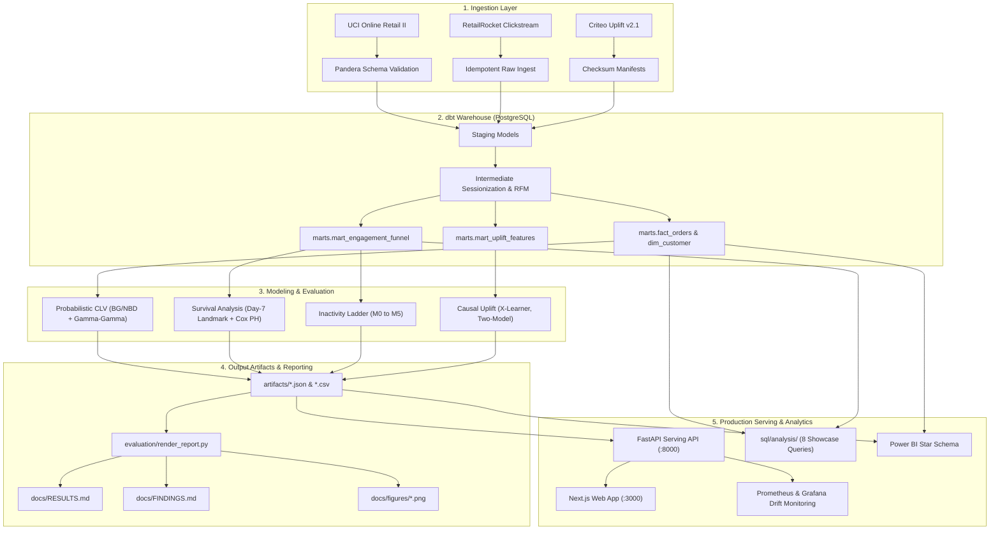

# RetentionIQ

RetentionIQ is an end-to-end, production-grade retention decision platform built on three public e-commerce and marketing datasets ([UCI Online Retail II](https://archive.ics.uci.edu/dataset/502/online+retail+ii), [RetailRocket](https://www.kaggle.com/datasets/retailrocket/ecommerce-dataset), and [Criteo Uplift v2.1](https://ailab.criteo.com/criteo-uplift-prediction-dataset/)). Rather than relying on static 30-day heuristics or naive response models, RetentionIQ isolates incremental causal impact and optimizes intervention unit economics. It was built to test three claims. The spec v0.6 run (2026-11-10) gives a mixed answer, reported as-is per the spec's guiding principle:

1. **Uplift targeting beats propensity targeting.** *Partly.* On visits, the selected S-learner has a higher test Qini than the response model, but the paired bootstrap difference is not significant (p = 0.096). On conversions, and on profit under the scenario economics, propensity targeting does better.
2. **A day-7 landmark beats first-session survival modeling.** *Not supported.* Held-out concordance is 0.506 vs 0.507. Week-1 activity tiers do separate (log-rank p ≈ 1e-75), but too weakly to rank visitors.
3. **Unit-economics thresholds beat a fixed 0.50 cutoff.** The cost-optimal threshold ranges 0.13–0.67 across 9 cost/value scenarios. The economics are hypothetical, so this shows the method, not a measured gain.

Every definition, split, and gate is specified in [`PROJECT_SPEC.md`](PROJECT_SPEC.md) (v0.6). Full numerical benchmarks are rendered from pipeline outputs in [`docs/RESULTS.md`](docs/RESULTS.md), executive growth summaries are in [`docs/FINDINGS.md`](docs/FINDINGS.md), and analytical SQL showcases are cataloged in [`sql/README.md`](sql/README.md).

---

## 1. Five-Minute Quickstart (No Database or 15 GB Download Required)

Explore the full methodology and trained models locally in under 5 minutes using the bundled **synthetic** sample datasets (~3.9 MB total in `data/sample/`). They are generated with a seeded random generator by `scripts/make_sample.py` to mimic the real schemas; they are **not** drawn from the real datasets, so notebook outputs demonstrate the method, not real findings:

```bash
# 1. Install core dependencies and dev environment
make install

# 2. Run the three showcase notebooks on sample data
make demo

# 3. Validate analytical SQL showcase queries
make sql-check
```

The three standalone notebooks in `notebooks/` run top-to-bottom without requiring Postgres, Docker, or external downloads:
- [`notebooks/01_customer_intelligence.ipynb`](notebooks/01_customer_intelligence.ipynb): RFM segmentation, K-Means clustering, BG/NBD & Gamma-Gamma probabilistic CLV, and cohort retention.
- [`notebooks/02_inactivity_and_survival.ipynb`](notebooks/02_inactivity_and_survival.ipynb): RetailRocket clickstream sessionization, first-session Cox baseline, day-7 landmark analysis, and cost-optimal threshold curves.
- [`notebooks/03_uplift_targeting.ipynb`](notebooks/03_uplift_targeting.ipynb): Criteo trial balance tests, response propensity vs true uplift, X-Learner CATE estimation, Qini curves, decile calibration, and reach optimization.

---

## 2. Key Findings & Empirical Visualizations

All numbers and figures below come from the full run under **spec v0.6 (git `20f499a`, 2026-11-10, 4-core Codespace)**. Full tables with confidence intervals: [`docs/RESULTS.md`](docs/RESULTS.md); executive summary: [`docs/FINDINGS.md`](docs/FINDINGS.md). Both are generated from `artifacts/` by `make report`.

### A. Inactivity Prediction (RetailRocket)
87.4% of test-snapshot visitors did not return within the 30-day prediction window, so PR-AUC on the inactive class starts near 0.874 for a random score.

| Model Ladder PR-AUC | Top Feature Drivers (TreeSHAP) |
| :---: | :---: |
|  |  |

- **Champion:** LightGBM M4, test PR-AUC **0.9521** [0.9493, 0.9550] vs 0.9300 for naive recency. The v0.6 parsimony rule found no simpler model statistically tied with it. M5 (MLP, 6-config grid) reached 0.9514.
- **Returners:** among the top 10% scored most likely to return, lift over the returner base rate is 3.51x.
- **Drivers:** `recency_vs_typical_gap`, `recency_days`, `tenure_days`.
- **Promotion:** M4 passed all 5 gates in spec §9.1 against the M1 reference and is registered in MLflow.

### B. Time to Inactivity: First Session vs Day-7 Landmark
| Day-7 Landmark Kaplan-Meier Survival Curves |
| :---: |
|  |

- **First session:** held-out Cox concordance **0.507**, essentially random.
- **Day-7 landmark:** **0.506**, no improvement (on a different population of 43,860 visitors still observable at day 7). Each week-1 feature on its own ranks at 0.499–0.510.
- **Tiers:** mean time to inactivity is 11.8 / 13.2 / 16.6 days for 1 / 2–3 / 4+ week-1 sessions (log-rank p ≈ 1e-75). The difference is real but small, and 70% of visitors fall in the 1-session tier.

### C. Treatment Intelligence: Uplift vs Propensity (Criteo, N = 13,979,592)
| Qini Curves (Visit) | Decile Calibration (Visit) | Campaign Net Value vs Reach |
| :---: | :---: | :---: |
|  |  |  |

- **Average effect:** treatment raised visits by +1.03 pp (+27%) and conversions by +0.115 pp (+59%). The arms are balanced (max |SMD| 0.049).
- **Visits:** the S-learner (selected on validation Qini) scored test Qini 0.0958 vs 0.0864 for the response model, but the bootstrap difference is not significant (p = 0.096). The causal forest (0.0911) is the only strategy significantly above the response model (p = 0.004). The cross-fitted X-learner (0.0834) and T-learner (0.0733) score below it.
- **Conversions:** the response model has the best test Qini (0.1921). No uplift learner beats it.
- **Profit (SCENARIO: $0.01 per impression, $10 per conversion):** net value peaks at 22% reach for the response model ($22.9k) and at 19% for the S-learner ($21.1k).

---

## 3. Architecture & Data Flow



---

## 4. The Three Case Studies (Never Joined)

The three datasets represent distinct e-commerce and marketing domains and are maintained in completely isolated pipelines:

| Case Study | Dataset | Core Business Problem | Methods & Models | Key Outcomes |
| :--- | :--- | :--- | :--- | :--- |
| **Customer Intelligence** | [UCI Online Retail II](https://archive.ics.uci.edu/dataset/502/online+retail+ii) | Revenue concentration, customer lifetime value, and cohort retention | Behavioral RFM, K-Means clustering, BG/NBD & Gamma-Gamma CLV | Top 10% of customers generate 63.8% of revenue (Gini 0.74); BG/NBD 90-day purchase MAE 0.689 vs 0.701 naive (1.6% better). Known bug: Gamma-Gamma spend predictions are NaN/negative for some customers |
| **Inactivity & Survival** | [RetailRocket](https://www.kaggle.com/datasets/retailrocket/ecommerce-dataset) | Clickstream engagement, churn prediction, and time-to-inactivity | Model ladder (M0–M5), TreeSHAP, Day-7 Landmark Cox PH, Kaplan-Meier | First-session Cox concordance 0.507 (near random); the day-7 landmark does not improve it (0.506) |
| **Treatment Intelligence** | [Criteo Uplift v2.1](https://ailab.criteo.com/criteo-uplift-prediction-dataset/) | Ad retargeting efficiency and incremental conversion optimization | RCT balance checks, Two-Model, 2-fold cross-fitted X-Learner, Qini curves | Visits: S-learner above propensity on test Qini (0.096 vs 0.086, not significant); conversions and scenario profit: propensity is better |

---

## 5. Methodology & Engineering Standards

- **Zero-Leakage Guarantees:**
  - Strict temporal cutoffs on feature generation.
  - X-Learner first-stage models use 2-fold cross-fitting to eliminate in-sample counterfactual imputation leakage.
  - Day-7 landmark survival analysis strictly bounds covariates to $[origin, origin + 7\text{ days})$ and excludes pre-landmark events.
- **Anti-Hallucination Policy:** `docs/RESULTS.md`, `docs/FINDINGS.md` and `docs/figures/` are generated only from `artifacts/` by `evaluation/render_report.py`, which has no fallback values and refuses to run when `artifacts/` is empty. Numbers quoted in this README name the run (spec version, git SHA) they come from.
- **Low-Latency Production Serving:**
  - FastAPI serving layer (`src/retentioniq/serving/app.py`) serves `/v1/churn/predict`, `/v1/churn/batch` and `/v1/uplift/score`.
  - LightGBM booster fast path. v0.6 benchmark (4 CPU): 668 req/s, single-record p99 2.9 ms at concurrency 1 and 38 ms at concurrency 8; all spec §9.2 SLOs met.
  - Exact native TreeSHAP attribution is computed dynamically for top risk drivers.
  - Exposes Prometheus `/metrics` for latency, throughput, and error rates.
- **Code Quality & Typing:**
  - Python 3.11 with 100% strict type hints (`mypy --strict` clean).
  - Strict linting and formatting via `ruff`.
  - Deterministic random seed (`SEED = 20261002`) across all splits, initializations, and bootstrap draws.

---

## 6. Honest Systems Trade-offs & Limitations

1. **S-Learner Feature Regularization:** Single-model S-learners on high-dimensional feature spaces (such as Criteo) frequently regularize the binary treatment indicator toward zero split count and gain. RetentionIQ includes automated S-learner diagnostics (`artifacts/uplift_s_learner_diagnostics.json`) and provides `s_learner_lgbm_fullcol` (`colsample_bytree=1.0`) to force treatment split consideration.
2. **First-Session Survival Predictability:** First-session browsing engagement (minutes, pageviews, categories) has a held-out concordance index of 0.507, and a day-7 landmark does not improve on it (0.506). On this data, neither the first session nor the first week ranks time-to-inactivity usefully; the timing signal would have to come from features outside the clickstream.
3. **Hypothetical Economic Scenarios:** Campaign simulation and cost-optimal operating thresholds rely on unit-economic assumptions ($0.01 per impression, $10 per conversion). These are clearly labeled throughout code and reports as `SCENARIO - hypothetical cost/value, not observed data`.
4. **Compute Scaling Constraints:** To keep evaluation feasible on local developer workstations, training splits for the 14M-row Criteo trial are capped at 3,000,000 rows. The optional learning curve experiment (`--learning-curve`) empirically evaluates performance scaling across 500k, 1M, 2M, and 3M rows.

---

## 7. Full Production Reproduction (15 GB Warehouse)

To reproduce the complete pipeline from scratch using PostgreSQL, dbt, and the full raw datasets:

```bash
# 1. Start database and MLflow tracking server
make up

# 2. Download the three raw public datasets (~15 GB)
make data

# 3. Validate Pandera contracts and load raw data into Postgres
make ingest

# 4. Build and test dbt marts (staging -> intermediate -> marts)
make dbt

# 5. Run full model evaluation across all stages
make evaluate

# 6. Render docs/RESULTS.md and docs/FINDINGS.md from artifacts
make report

# 7. Evaluate model promotion gates and register champion in MLflow
uv run retentioniq promote

# 8. Start local FastAPI serving and Next.js frontend
make serve
```

### Hardware & Runtime Expectations
- **Minimum Requirements:** 4 CPU cores, 16 GB RAM, 25 GB free disk space.
- **Full Pipeline Runtime:** ~45-60 minutes on an 8-core Apple Silicon / modern x86 Linux workstation.
