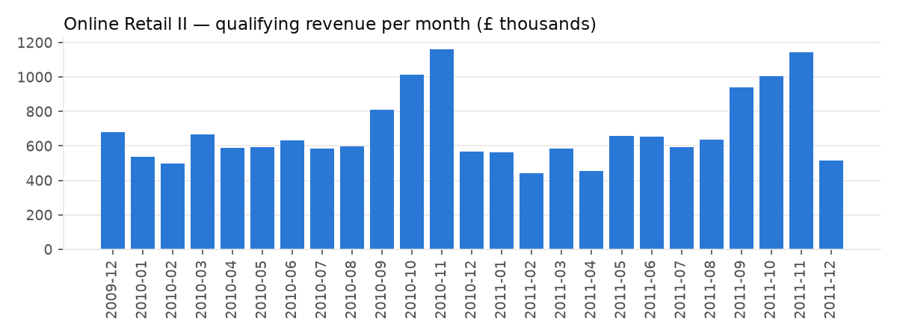
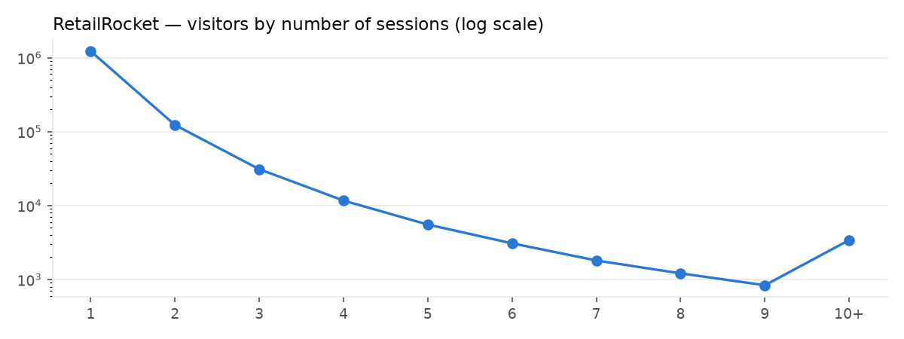
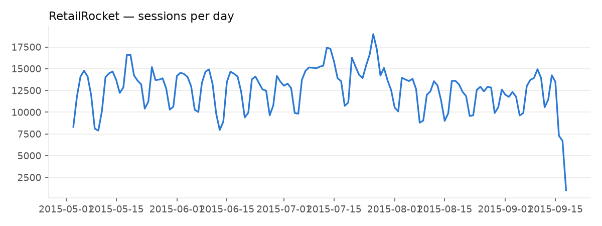

# RetentionIQ — Exploratory data analysis

_Generated by `retentioniq evaluate --only eda` from the warehouse marts. Numbers are computed, not typed._

## Online Retail II (transactions)

- 5,852 customers placed 36,594 qualifying orders; 72.4% ordered more than once.
- Orders per customer — median 3, p90 13, p99 46: a long tail of heavy buyers.
- Order value — median £303, p90 £827, p99 £3,528.
- Median gap between a customer's orders: 25 days (p75 62).
- Cancellations are 1.8% of lines and 7.1% of gross line value; lines without a customer ID are 22.5% of lines (15.1% of gross value) and are excluded from customer analytics (PROJECT_SPEC §4.3).
- Strong seasonality: revenue peaks in 2010-11-01 and is lowest in 2011-02-01 (partial edge months excluded).

## RetailRocket (behaviour)

- 1,407,580 visitors, 1,761,675 sessions over 139 days; **87.1% of visitors never return** after their first session.
- Only 0.83% of visitors ever purchase. Session funnel: view→cart 2.5%, cart→purchase 32.5%, overall 0.81%.
- Among returning visitors, the gap between sessions has median 1.2 days (p75 8.1, p90 30.9); 10.2% of return gaps exceed 30 days.

## Criteo (experiment)

- 13,979,592 users, 85.00% treated. Visit rate 4.70%, conversion rate 0.292% (6.2% of visits convert). Only 3.6% of treated users were actually exposed — `exposure` is post-treatment and excluded from models (§4.4).

## Hypotheses carried into modelling

| # | Hypothesis (from the evidence above) | Where it is tested |
|---|---|---|
| H1 | With 87.1% single-session visitors, "inactivity" for all visitors is trivial; the modelling population must be returning visitors. | §4.1 eligibility; `min_sessions` sensitivity |
| H2 | Recency *relative to a visitor's own rhythm* predicts inactivity better than raw recency, because session gaps vary widely between visitors. | Temporal family in the ablation; SHAP |
| H3 | Carts and purchases are rare (view→cart 2.5%), so funnel features add little beyond engagement volume. | Funnel step of the ablation |
| H4 | Value is concentrated in a small set of frequent buyers (median 3 order, p99 46); simple RFM already captures most of the structure that predicts future buying. | RFM vs learned segmentation |
| H5 | Retention drops sharply after the first month and then flattens. | Cohort matrices and curves |
| H6 | With a 4.7% visit rate and a 0.29% conversion rate, treatment effects on conversions will be too sparse to rank reliably below the most engaged users. | Heterogeneity deciles; uplift vs propensity targeting |
