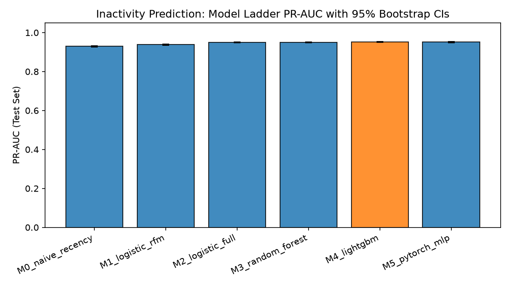
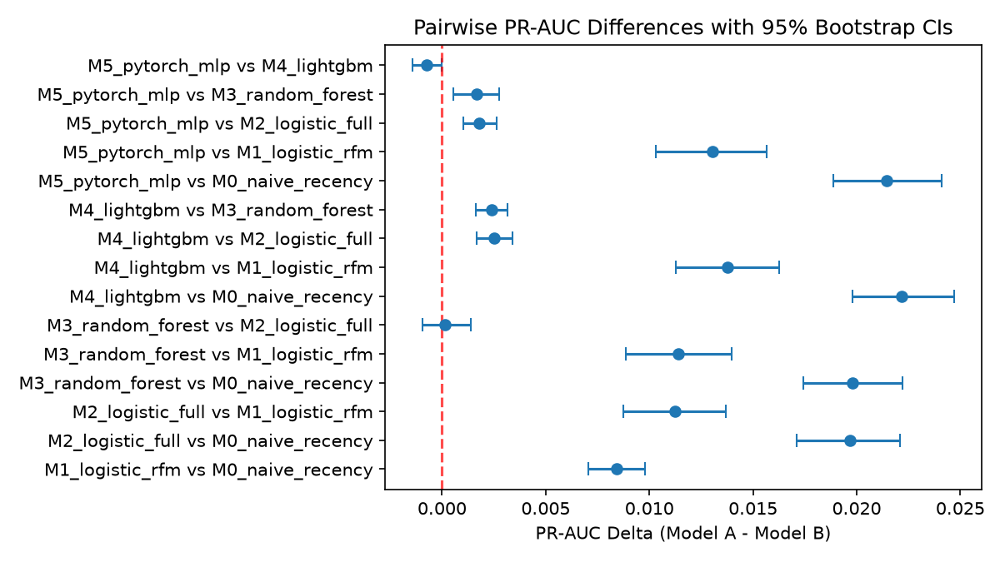
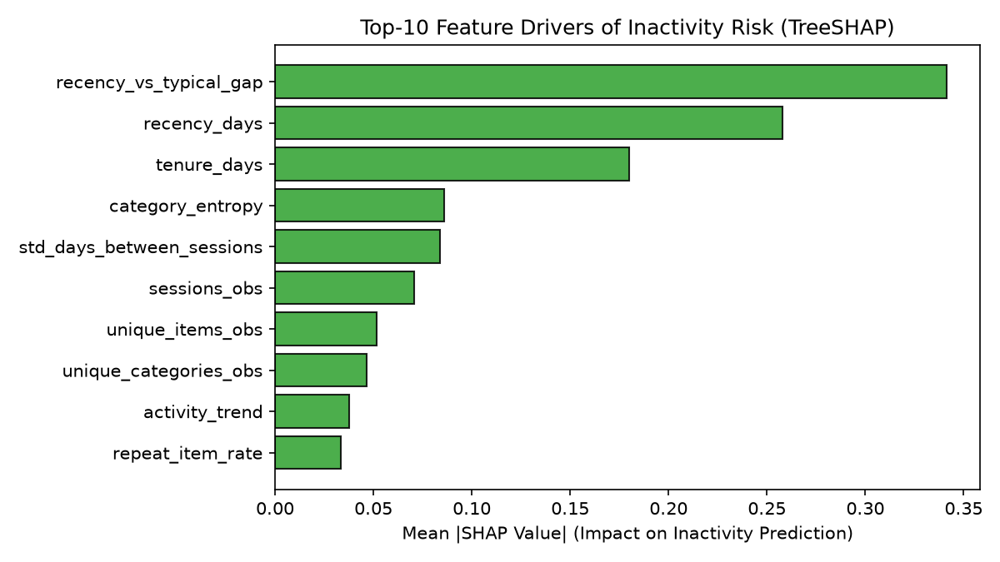
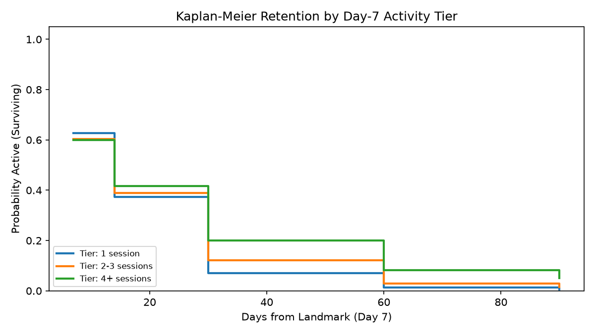
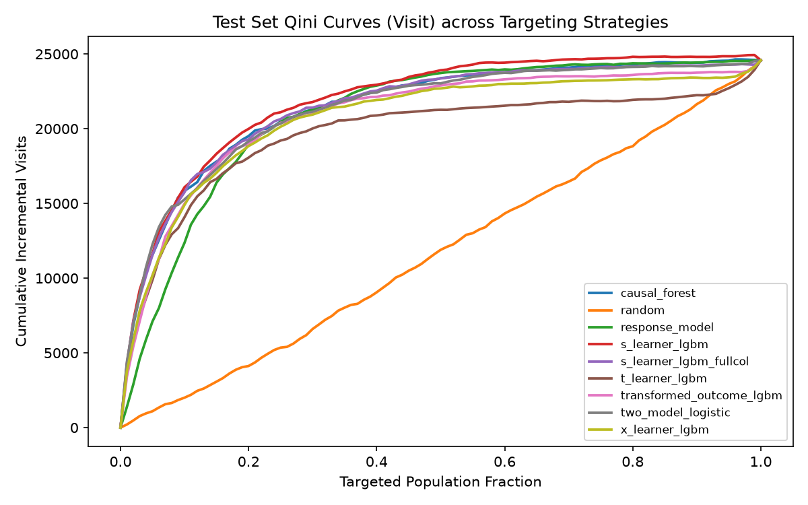
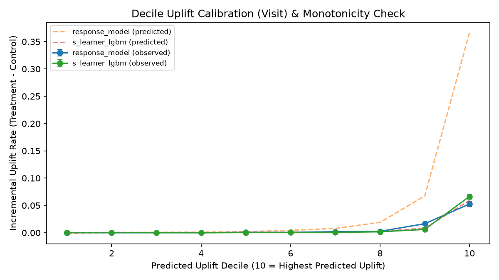
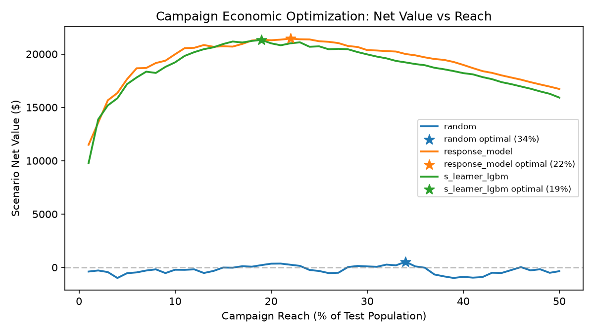

# RetentionIQ — Results

_Generated by `evaluation/render_report.py` from `artifacts/`. Do not edit by hand._
_Exploratory analysis and the hypotheses tested here: [EDA.md](EDA.md)._
_Spec version(s): ['0.6', '0.6.1', '0.6.3']; git: ['20f499a2', '67d6365c', 'f20edae9']._

## Customer intelligence (Online Retail II)

Revenue concentration: the top 10% of customers generate 63.8% of qualifying revenue (top 1%: 31.8%; Gini 0.74).

### RFM segments (full history)
| rfm_segment         |   customers |   share_customers |   share_revenue |   avg_order_value |   mean_frequency |   repeat_purchase_rate |
|:--------------------|------------:|------------------:|----------------:|------------------:|-----------------:|-----------------------:|
| Champions           |        1007 |             0.172 |           0.650 |           551.149 |           20.046 |                  1.000 |
| Loyal               |        1128 |             0.193 |           0.175 |           400.852 |            6.623 |                  1.000 |
| At Risk             |         683 |             0.117 |           0.096 |           445.019 |            5.425 |                  0.990 |
| Potential Loyalists |         559 |             0.096 |           0.023 |           269.793 |            2.574 |                  0.916 |
| Needs Attention     |         740 |             0.126 |           0.022 |           267.938 |            1.865 |                  0.493 |
| Lost                |         944 |             0.161 |           0.018 |           252.448 |            1.294 |                  0.247 |
| Hibernating         |         715 |             0.122 |           0.016 |           246.263 |            1.540 |                  0.418 |
| New Customers       |          76 |             0.013 |           0.001 |           202.970 |            1.184 |                  0.184 |

### RFM vs learned segmentation (cutoff 2011-09-11, 90-day future window, chosen k = 6)

Both segmentations use only pre-cutoff orders; *future-activity AUC* measures how well segment membership alone separates customers who buy again in the held-out window.

| segmentation     |   groups |   future-activity AUC |   silhouette |
|:-----------------|---------:|----------------------:|-------------:|
| rfm_segments     |        8 |                 0.769 |        0.059 |
| kmeans_clusters  |        6 |                 0.761 |        0.280 |
| gmm_clusters     |        6 |                 0.758 |      nan     |
| hdbscan_clusters |        7 |                 0.727 |      nan     |

Agreement between RFM segments and K-Means clusters (ARI): 0.360.

### Cohort retention (mean across first-purchase cohorts)
|    M1 |    M3 |    M6 |   M12 |
|------:|------:|------:|------:|
| 0.210 | 0.217 | 0.179 | 0.183 |

## Customer lifetime value (Online Retail II)

Calibration ends 2011-09-10; evaluated on the next 90 days for 5,256 customers (actual holdout revenue 2,501,235).

| model                              |   purchase MAE |   spend MAE |   Spearman (spend) |   predicted revenue |
|:-----------------------------------|---------------:|------------:|-------------------:|--------------------:|
| BG/NBD + empirical_bayes_lognormal |         0.6941 |    376.4700 |             0.5788 |        1668222.9600 |
| naive historical rate              |         0.7007 |    367.1600 |             0.5253 |        1996150.5600 |

Spend model: Gamma-Gamma q=0.340 <= 1: population mean spend undefined; used empirical-Bayes log-normal instead.

### CLV by RFM segment (calibration-time segment)
| rfm_segment         |   n_customers |   avg_predicted_purchases_90d |   avg_actual_purchases_90d |   avg_predicted_spend_90d |   avg_actual_spend_90d |   total_predicted_spend_90d |   total_actual_spend_90d |   mae_purchases |   spearman_rank_corr |
|:--------------------|--------------:|------------------------------:|---------------------------:|--------------------------:|-----------------------:|----------------------------:|-------------------------:|----------------:|---------------------:|
| Champions           |           943 |                         2.210 |                      2.700 |                  1072.340 |               1543.840 |                 1011219.770 |              1455843.270 |           1.321 |                0.581 |
| Loyal               |           963 |                         0.810 |                      1.010 |                   317.780 |                380.490 |                  306020.460 |               366412.920 |           0.829 |                0.332 |
| Needs Attention     |           716 |                         0.320 |                      0.420 |                   116.690 |                355.580 |                   83552.120 |               254592.780 |           0.528 |                0.226 |
| Potential Loyalists |           446 |                         0.660 |                      0.960 |                   238.040 |                391.730 |                  106166.320 |               174712.850 |           0.874 |                0.338 |
| At Risk             |           644 |                         0.270 |                      0.440 |                   107.330 |                199.910 |                   69118.090 |               128740.380 |           0.515 |                0.227 |
| Hibernating         |           622 |                         0.170 |                      0.290 |                    61.250 |                 88.720 |                   38094.850 |                55184.750 |           0.374 |                0.114 |
| Lost                |           837 |                         0.110 |                      0.150 |                    39.010 |                 51.100 |                   32649.690 |                42770.800 |           0.229 |                0.154 |
| New Customers       |            85 |                         0.690 |                      1.020 |                   251.780 |                270.320 |                   21401.670 |                22977.060 |           0.942 |                0.302 |

## Visitor segmentation (RetailRocket)

Fit on training snapshots, judged on the test snapshot (chosen k = 4).

| segmentation       |   groups |   test inactivity AUC |
|:-------------------|---------:|----------------------:|
| rfm_grid           |       10 |                 0.720 |
| kmeans_behavioural |        4 |                 0.625 |

### Weekly retention by category of first item viewed
| first category   |    W1 |    W2 |    W4 |    W8 |
|:-----------------|------:|------:|------:|------:|
| category 140     | 0.037 | 0.018 | 0.011 | 0.006 |
| category 1482    | 0.037 | 0.019 | 0.011 | 0.007 |
| category 1532    | 0.028 | 0.014 | 0.008 | 0.005 |
| category 1600    | 0.052 | 0.025 | 0.013 | 0.008 |
| category 395     | 0.037 | 0.020 | 0.012 | 0.008 |
| other categories | 0.034 | 0.016 | 0.010 | 0.006 |
| unknown category | 0.024 | 0.013 | 0.008 | 0.005 |

## Inactivity prediction (RetailRocket)

Cutoffs: {'train': ['2015-06-06', '2015-06-13', '2015-06-20'], 'validation': ['2015-07-20'], 'test': ['2015-08-19']}. Rows: {'train': 105371, 'test': 34241, 'validation': 33896}. Base rate (inactive): {'test': 0.8735, 'train': 0.8624, 'validation': 0.8632}.

### Model ladder — test set (PR-AUC is primary; 95% bootstrap CIs)
| model            |   pr_auc |   pr_auc_ci_low |   pr_auc_ci_high |   pr_auc_returners |   returner_base_rate |   precision_returners@10 |   lift_returners@10 |   roc_auc |   precision@10 |   recall@10 |   brier |    ece | is_champion   |
|:-----------------|---------:|----------------:|-----------------:|-------------------:|---------------------:|-------------------------:|--------------------:|----------:|---------------:|------------:|--------:|-------:|:--------------|
| M0_naive_recency |   0.9300 |          0.9268 |           0.9334 |             0.2353 |               0.1265 |                   0.3186 |              2.5185 |    0.7017 |         0.9550 |      0.1093 |  0.1039 | 0.0132 | False         |
| M1_logistic_rfm  |   0.9384 |          0.9352 |           0.9418 |             0.3403 |               0.1265 |                   0.3896 |              3.0795 |    0.7241 |         0.9577 |      0.1096 |  0.0987 | 0.0076 | False         |
| M2_logistic_full |   0.9496 |          0.9468 |           0.9528 |             0.3957 |               0.1265 |                   0.4340 |              3.4304 |    0.7691 |         0.9728 |      0.1114 |  0.0946 | 0.0175 | False         |
| M3_random_forest |   0.9498 |          0.9470 |           0.9526 |             0.3882 |               0.1265 |                   0.4311 |              3.4073 |    0.7708 |         0.9763 |      0.1118 |  0.0938 | 0.0079 | False         |
| M4_lightgbm      |   0.9521 |          0.9493 |           0.9550 |             0.4084 |               0.1265 |                   0.4442 |              3.5112 |    0.7749 |         0.9801 |      0.1122 |  0.0933 | 0.0157 | True          |
| M5_pytorch_mlp   |   0.9514 |          0.9487 |           0.9545 |             0.4057 |               0.1265 |                   0.4355 |              3.4419 |    0.7737 |         0.9769 |      0.1118 |  0.0937 | 0.0176 | False         |

### Model selection rationale
- **Selection data**: validation
- **Best validation model**: `M4_lightgbm`
- **Selected champion**: `M4_lightgbm`
- **Delta vs best (validation)**: 0.0000
- **Rationale**: M4_lightgbm has the highest validation PR-AUC (0.9475). Every simpler model is significantly worse on validation (2 checked), so it is kept. Not eligible (single-record p95 over the 5 ms budget): M2_logistic_full (6.5 ms), M3_random_forest (72.5 ms).

Simpler models checked against the best (validation PR-AUC):

| model            |   delta_pr_auc |   ci_low |   ci_high | tied_with_best   |
|:-----------------|---------------:|---------:|----------:|:-----------------|
| M0_naive_recency |        -0.0275 |  -0.0299 |   -0.0250 | False            |
| M1_logistic_rfm  |        -0.0174 |  -0.0199 |   -0.0150 | False            |

### Pairwise model deltas (PR-AUC)
| model_a          | model_b          |   delta_pr_auc |   ci_low |   ci_high | significant   |
|:-----------------|:-----------------|---------------:|---------:|----------:|:--------------|
| M1_logistic_rfm  | M0_naive_recency |         0.0084 |   0.0071 |    0.0098 | True          |
| M2_logistic_full | M0_naive_recency |         0.0197 |   0.0171 |    0.0221 | True          |
| M2_logistic_full | M1_logistic_rfm  |         0.0113 |   0.0087 |    0.0137 | True          |
| M3_random_forest | M0_naive_recency |         0.0198 |   0.0174 |    0.0222 | True          |
| M3_random_forest | M1_logistic_rfm  |         0.0114 |   0.0089 |    0.0140 | True          |
| M3_random_forest | M2_logistic_full |         0.0001 |  -0.0010 |    0.0014 | False         |
| M4_lightgbm      | M0_naive_recency |         0.0222 |   0.0198 |    0.0247 | True          |
| M4_lightgbm      | M1_logistic_rfm  |         0.0138 |   0.0113 |    0.0163 | True          |
| M4_lightgbm      | M2_logistic_full |         0.0025 |   0.0017 |    0.0034 | True          |
| M4_lightgbm      | M3_random_forest |         0.0024 |   0.0016 |    0.0032 | True          |
| M5_pytorch_mlp   | M0_naive_recency |         0.0215 |   0.0189 |    0.0241 | True          |
| M5_pytorch_mlp   | M1_logistic_rfm  |         0.0130 |   0.0103 |    0.0156 | True          |
| M5_pytorch_mlp   | M2_logistic_full |         0.0018 |   0.0010 |    0.0026 | True          |
| M5_pytorch_mlp   | M3_random_forest |         0.0017 |   0.0005 |    0.0027 | True          |
| M5_pytorch_mlp   | M4_lightgbm      |        -0.0007 |  -0.0014 |   -0.0000 | True          |

### Cost-optimal operating threshold scenarios
_SCENARIO - hypothetical cost/value, not observed data_

|   cost_contact |   value_saved |   save_rate |   threshold |   share_contacted |   expected_profit | scenario_note                                         |
|---------------:|--------------:|------------:|------------:|------------------:|------------------:|:------------------------------------------------------|
|         0.5000 |       20.0000 |      0.1500 |      0.2620 |            0.9914 |        72628.0000 | SCENARIO - hypothetical cost/value, not observed data |
|         0.5000 |       50.0000 |      0.1500 |      0.1869 |            0.9959 |       207199.5000 | SCENARIO - hypothetical cost/value, not observed data |
|         0.5000 |      100.0000 |      0.1500 |      0.1245 |            0.9984 |       431526.5000 | SCENARIO - hypothetical cost/value, not observed data |
|         1.0000 |       20.0000 |      0.1500 |      0.3446 |            0.9851 |        55667.0000 | SCENARIO - hypothetical cost/value, not observed data |
|         1.0000 |       50.0000 |      0.1500 |      0.2063 |            0.9947 |       190132.0000 | SCENARIO - hypothetical cost/value, not observed data |
|         1.0000 |      100.0000 |      0.1500 |      0.1869 |            0.9959 |       414399.0000 | SCENARIO - hypothetical cost/value, not observed data |
|         2.0000 |       20.0000 |      0.1500 |      0.6715 |            0.9159 |        22447.0000 | SCENARIO - hypothetical cost/value, not observed data |
|         2.0000 |       50.0000 |      0.1500 |      0.2620 |            0.9914 |       156110.5000 | SCENARIO - hypothetical cost/value, not observed data |
|         2.0000 |      100.0000 |      0.1500 |      0.2063 |            0.9947 |       380264.0000 | SCENARIO - hypothetical cost/value, not observed data |

### Error analysis by segment (champion model)
| dimension      | segment            |     n |   actual_inactive |   actual_active |   fp |   fn |      fpr |      fnr |
|:---------------|:-------------------|------:|------------------:|----------------:|-----:|-----:|---------:|---------:|
| tenure_days    | <7d                |  4372 |              3659 |             713 |  666 |   28 |   0.9341 |   0.0077 |
| tenure_days    | 7-14d              |  5310 |              4702 |             608 |  567 |   22 |   0.9326 |   0.0047 |
| tenure_days    | 14-30d             | 18629 |             17233 |            1396 | 1309 |   45 |   0.9377 |   0.0026 |
| tenure_days    | 30d+               |  5930 |              4315 |            1615 | 1244 |  146 |   0.7703 |   0.0338 |
| sessions_obs   | low (T1)           | 24166 |             21948 |            2218 | 2217 |    0 |   0.9995 |   0.0000 |
| sessions_obs   | medium (T2)        |     0 |                 0 |               0 |    0 |    0 | nan      | nan      |
| sessions_obs   | high (T3)          | 10075 |              7961 |            2114 | 1569 |  241 |   0.7422 |   0.0303 |
| ever_purchased | non_purchasers (0) | 32736 |             28707 |            4029 | 3562 |  212 |   0.8841 |   0.0074 |
| ever_purchased | purchasers (1)     |  1505 |              1202 |             303 |  224 |   29 |   0.7393 |   0.0241 |

### Feature-family ablation (cumulative)
| model       | features                                            |   n_features |   test_pr_auc |   delta_test_pr_auc |   delta_ci_low |   delta_ci_high |
|:------------|:----------------------------------------------------|-------------:|--------------:|--------------------:|---------------:|----------------:|
| M4_lightgbm | rfm                                                 |            3 |        0.9387 |            nan      |       nan      |        nan      |
| M4_lightgbm | rfm+transactions                                    |            7 |        0.9393 |              0.0005 |         0.0001 |          0.0010 |
| M4_lightgbm | rfm+transactions+engagement                         |           14 |        0.9427 |              0.0034 |         0.0020 |          0.0049 |
| M4_lightgbm | rfm+transactions+engagement+funnel                  |           19 |        0.9425 |             -0.0001 |        -0.0006 |          0.0004 |
| M4_lightgbm | rfm+transactions+engagement+funnel+temporal         |           25 |        0.9505 |              0.0080 |         0.0062 |          0.0099 |
| M4_lightgbm | rfm+transactions+engagement+funnel+temporal+product |           30 |        0.9521 |              0.0017 |         0.0007 |          0.0026 |
| M2_logistic | rfm                                                 |            3 |        0.9384 |            nan      |       nan      |        nan      |
| M2_logistic | rfm+transactions                                    |            7 |        0.9387 |              0.0004 |        -0.0000 |          0.0008 |
| M2_logistic | rfm+transactions+engagement                         |           14 |        0.9423 |              0.0035 |         0.0021 |          0.0049 |
| M2_logistic | rfm+transactions+engagement+funnel                  |           19 |        0.9424 |              0.0001 |        -0.0000 |          0.0002 |
| M2_logistic | rfm+transactions+engagement+funnel+temporal         |           25 |        0.9481 |              0.0058 |         0.0040 |          0.0075 |
| M2_logistic | rfm+transactions+engagement+funnel+temporal+product |           30 |        0.9496 |              0.0015 |         0.0008 |          0.0022 |

### Sensitivity of the label definition
Model ranking (M4 > M1) stable across all settings: **True**.

| setting         |   M1_logistic_rfm |   M4_lightgbm |
|:----------------|------------------:|--------------:|
| horizon_21d     |            0.9437 |        0.9555 |
| min_sessions_1  |            0.9764 |        0.9811 |
| min_sessions_3  |            0.9070 |        0.9276 |
| observation_21d |            0.9124 |        0.9336 |
| primary         |            0.9384 |        0.9521 |
| session_gap_15m |            0.9413 |        0.9549 |
| session_gap_60m |            0.9350 |        0.9501 |

### What drives inactivity risk (mean |SHAP|, M4)
| feature                   | family   |   mean_abs_shap |   value_shap_corr |
|:--------------------------|:---------|----------------:|------------------:|
| recency_vs_typical_gap    | temporal |          0.3413 |            0.5357 |
| recency_days              | rfm      |          0.2578 |            0.9092 |
| tenure_days               | temporal |          0.1800 |           -0.8459 |
| category_entropy          | product  |          0.0860 |           -0.9208 |
| std_days_between_sessions | temporal |          0.0840 |           -0.6094 |
| sessions_obs              | rfm      |          0.0708 |           -0.6375 |
| unique_items_obs          | product  |          0.0518 |           -0.1340 |
| unique_categories_obs     | product  |          0.0464 |           -0.2669 |
| activity_trend            | temporal |          0.0375 |           -0.9020 |
| repeat_item_rate          | product  |          0.0335 |            0.9004 |

### Segment performance
| segment        | model           |     n |   base_rate |   pr_auc |   roc_auc |   brier |
|:---------------|:----------------|------:|------------:|---------:|----------:|--------:|
| all            | M1_logistic_rfm | 34241 |      0.8735 |   0.9384 |    0.7241 |  0.0987 |
| all            | M4_lightgbm     | 34241 |      0.8735 |   0.9521 |    0.7749 |  0.0933 |
| new_visitors   | M1_logistic_rfm |  9682 |      0.8636 |   0.9204 |    0.6753 |  0.1125 |
| new_visitors   | M4_lightgbm     |  9682 |      0.8636 |   0.9289 |    0.7001 |  0.1085 |
| low_activity   | M1_logistic_rfm | 24166 |      0.9082 |   0.9458 |    0.6655 |  0.0811 |
| low_activity   | M4_lightgbm     | 24166 |      0.9082 |   0.9578 |    0.7258 |  0.0783 |
| purchasers     | M1_logistic_rfm |  1505 |      0.7987 |   0.9063 |    0.7344 |  0.1351 |
| purchasers     | M4_lightgbm     |  1505 |      0.7987 |   0.9309 |    0.7916 |  0.1246 |
| non_purchasers | M1_logistic_rfm | 32736 |      0.8769 |   0.9395 |    0.7222 |  0.0970 |
| non_purchasers | M4_lightgbm     | 32736 |      0.8769 |   0.9528 |    0.7725 |  0.0919 |
| category_1051  | M1_logistic_rfm |  1033 |      0.8683 |   0.9322 |    0.7018 |  0.1018 |
| category_1051  | M4_lightgbm     |  1033 |      0.8683 |   0.9515 |    0.7747 |  0.0956 |
| category_342   | M1_logistic_rfm |   894 |      0.9195 |   0.9623 |    0.7535 |  0.0651 |
| category_342   | M4_lightgbm     |   894 |      0.9195 |   0.9865 |    0.8697 |  0.0594 |
| category_1483  | M1_logistic_rfm |   856 |      0.8540 |   0.9312 |    0.7409 |  0.1092 |
| category_1483  | M4_lightgbm     |   856 |      0.8540 |   0.9401 |    0.7804 |  0.1021 |
| category_959   | M1_logistic_rfm |   853 |      0.8699 |   0.9497 |    0.7642 |  0.0970 |
| category_959   | M4_lightgbm     |   853 |      0.8699 |   0.9625 |    0.8101 |  0.0883 |
| category_5     | M1_logistic_rfm |   682 |      0.9076 |   0.9553 |    0.7240 |  0.0804 |
| category_5     | M4_lightgbm     |   682 |      0.9076 |   0.9532 |    0.6991 |  0.0840 |

### Inactivity figures

## Time to inactivity (survival)
Population 155,751 returning visitors; 148,590 events, 7,161 censored. Log-rank test across first-session types: p = 0.00057.
### First-session Cox model concordance & baselines
- **Held-out test concordance**: 0.507
- **Single-covariate baseline (`first_session_events`)**: 0.505
- **Random-score baseline**: 0.50
- **PH violations (p < 0.01)**: ['first_session_events', 'first_session_items', 'first_session_weekend']
- **Stratified covariates**: ['first_session_weekend']
- **Interpretation**: Held-out concordance of 0.507 vs a random baseline of 0.50: first-session engagement alone ranks return timing little better than chance.
| group_by           | group       |      n |   events |   day |   survival |   ci_low |   ci_high |   median_days |
|:-------------------|:------------|-------:|---------:|------:|-----------:|---------:|----------:|--------------:|
| all                | all         | 155751 |   148590 |     7 |      0.294 |    0.292 |     0.297 |         1.305 |
| all                | all         | 155751 |   148590 |    14 |      0.182 |    0.180 |     0.184 |         1.305 |
| all                | all         | 155751 |   148590 |    30 |      0.041 |    0.040 |     0.042 |         1.305 |
| all                | all         | 155751 |   148590 |    60 |      0.008 |    0.008 |     0.009 |         1.305 |
| all                | all         | 155751 |   148590 |    90 |      0.004 |    0.003 |     0.004 |         1.305 |
| first_session_type | carted      |   4778 |     4558 |     7 |      0.275 |    0.262 |     0.288 |         1.476 |
| first_session_type | carted      |   4778 |     4558 |    14 |      0.162 |    0.152 |     0.173 |         1.476 |
| first_session_type | carted      |   4778 |     4558 |    30 |      0.045 |    0.039 |     0.051 |         1.476 |
| first_session_type | carted      |   4778 |     4558 |    60 |      0.011 |    0.008 |     0.015 |         1.476 |
| first_session_type | carted      |   4778 |     4558 |    90 |      0.005 |    0.002 |     0.008 |         1.476 |
| first_session_type | purchased   |   1845 |     1760 |     7 |      0.313 |    0.292 |     0.334 |         2.112 |
| first_session_type | purchased   |   1845 |     1760 |    14 |      0.195 |    0.177 |     0.214 |         2.112 |
| first_session_type | purchased   |   1845 |     1760 |    30 |      0.052 |    0.042 |     0.063 |         2.112 |
| first_session_type | purchased   |   1845 |     1760 |    60 |      0.011 |    0.006 |     0.018 |         2.112 |
| first_session_type | purchased   |   1845 |     1760 |    90 |      0.007 |    0.004 |     0.013 |         2.112 |
| first_session_type | viewed_only | 149128 |   142272 |     7 |      0.295 |    0.292 |     0.297 |         1.285 |
| first_session_type | viewed_only | 149128 |   142272 |    14 |      0.183 |    0.181 |     0.185 |         1.285 |
| first_session_type | viewed_only | 149128 |   142272 |    30 |      0.041 |    0.040 |     0.042 |         1.285 |
| first_session_type | viewed_only | 149128 |   142272 |    60 |      0.008 |    0.008 |     0.009 |         1.285 |
| first_session_type | viewed_only | 149128 |   142272 |    90 |      0.004 |    0.003 |     0.004 |         1.285 |
### Cox hazard ratios
| covariate                |   coef |   hazard_ratio |   hr_ci_low |   hr_ci_high |     p |   ph_test_p | ph_violated   |
|:-------------------------|-------:|---------------:|------------:|-------------:|------:|------------:|:--------------|
| first_session_events     |  0.029 |          1.030 |       0.990 |        1.070 | 0.140 |       0.000 | True          |
| first_session_carted     |  0.008 |          1.008 |       0.973 |        1.043 | 0.673 |       0.714 | False         |
| first_session_purchased  | -0.101 |          0.904 |       0.851 |        0.959 | 0.001 |       0.903 | False         |
| first_session_items      | -0.056 |          0.945 |       0.910 |        0.983 | 0.004 |       0.006 | True          |
| first_session_categories | -0.063 |          0.939 |       0.917 |        0.962 | 0.000 |       0.720 | False         |
| first_session_minutes    | -0.003 |          0.997 |       0.987 |        1.008 | 0.637 |       0.042 | False         |
### Day-7 Landmark survival analysis
- **Landmark horizon ($t_{LM}$)**: 7 days
- **Eligible population**: 43,860 visitors (39,303 events, 4,557 censored)
- **Held-out concordance**: 0.506 (vs first-session 0.507; delta **+-0.001**)
- **Activity tier log-rank test**: p = 2.13e-75
- **Stratified covariates**: none
- **Interpretation**: Evaluating visitors at a day-7 landmark yields test concordance of 0.506 vs 0.507 for first-session engagement (delta -0.001; the two models are evaluated on different populations). 7-day behavioral history does not improve ranking.
#### Landmark Cox hazard ratios
| covariate                     |   coef |   hazard_ratio |   hr_ci_low |   hr_ci_high |     p |   ph_test_p | ph_violated   |
|:------------------------------|-------:|---------------:|------------:|-------------:|------:|------------:|:--------------|
| sessions_7d                   | -0.194 |          0.823 |       0.761 |        0.891 | 0.000 |       0.795 | False         |
| events_7d                     |  0.169 |          1.184 |       1.131 |        1.239 | 0.000 |       0.008 | True          |
| active_days_7d                | -0.136 |          0.873 |       0.777 |        0.980 | 0.021 |       0.368 | False         |
| carted_7d                     |  0.009 |          1.009 |       0.950 |        1.072 | 0.775 |       0.356 | False         |
| purchased_7d                  | -0.056 |          0.945 |       0.863 |        1.035 | 0.225 |       0.094 | False         |
| unique_items_7d               | -0.165 |          0.848 |       0.806 |        0.892 | 0.000 |       0.547 | False         |
| unique_categories_7d          | -0.146 |          0.865 |       0.830 |        0.901 | 0.000 |       0.970 | False         |
| days_since_last_session_at_7d |  0.002 |          1.002 |       0.991 |        1.013 | 0.728 |       0.000 | True          |
#### Landmark Kaplan-Meier survival by 7-day activity tier
| group_by      | group        |     n |   events |   day |   survival |   ci_low |   ci_high |   median_days |
|:--------------|:-------------|------:|---------:|------:|-----------:|---------:|----------:|--------------:|
| activity_tier | 1 session    | 30690 |    27737 |     7 |      0.627 |    0.621 |     0.632 |        10.108 |
| activity_tier | 1 session    | 30690 |    27737 |    14 |      0.373 |    0.367 |     0.378 |        10.108 |
| activity_tier | 1 session    | 30690 |    27737 |    30 |      0.071 |    0.067 |     0.074 |        10.108 |
| activity_tier | 1 session    | 30690 |    27737 |    60 |      0.013 |    0.011 |     0.014 |        10.108 |
| activity_tier | 1 session    | 30690 |    27737 |    90 |      0.005 |    0.004 |     0.006 |        10.108 |
| activity_tier | 2-3 sessions |  9892 |     8744 |     7 |      0.603 |    0.593 |     0.613 |        10.040 |
| activity_tier | 2-3 sessions |  9892 |     8744 |    14 |      0.388 |    0.379 |     0.398 |        10.040 |
| activity_tier | 2-3 sessions |  9892 |     8744 |    30 |      0.121 |    0.114 |     0.128 |        10.040 |
| activity_tier | 2-3 sessions |  9892 |     8744 |    60 |      0.030 |    0.026 |     0.034 |        10.040 |
| activity_tier | 2-3 sessions |  9892 |     8744 |    90 |      0.015 |    0.012 |     0.018 |        10.040 |
| activity_tier | 4+ sessions  |  3278 |     2822 |     7 |      0.600 |    0.583 |     0.617 |        10.293 |
| activity_tier | 4+ sessions  |  3278 |     2822 |    14 |      0.416 |    0.399 |     0.433 |        10.293 |
| activity_tier | 4+ sessions  |  3278 |     2822 |    30 |      0.199 |    0.185 |     0.214 |        10.293 |
| activity_tier | 4+ sessions  |  3278 |     2822 |    60 |      0.081 |    0.071 |     0.092 |        10.293 |
| activity_tier | 4+ sessions  |  3278 |     2822 |    90 |      0.051 |    0.042 |     0.061 |        10.293 |
### Landmark survival curves

## Experiment & uplift (Criteo)

N = 13,979,592. Treatment share 0.8500 vs designed 0.85; covariate balance max |SMD| = 0.0488 (passes: True).

| outcome    |   control |   treatment |     ATE | ATE 95% CI         |   relative lift |   p (Holm) |
|:-----------|----------:|------------:|--------:|:-------------------|----------------:|-----------:|
| visit      |   0.03820 |     0.04854 | 0.01034 | [0.01005, 0.01063] |         0.27074 |    0.00000 |
| conversion |   0.00194 |     0.00309 | 0.00115 | [0.00108, 0.00122] |         0.59449 |    0.00000 |

### Targeting strategies — test set (selected on validation Qini: **s_learner_lgbm**)
| strategy                 | outcome    |   qini_coefficient |    auuc |   uplift@1 |   uplift@10 |   uplift@30 |
|:-------------------------|:-----------|-------------------:|--------:|-----------:|------------:|------------:|
| random                   | visit      |            -0.0054 | -0.0056 |     0.0088 |      0.0084 |      0.0093 |
| response_model           | visit      |             0.0864 |  0.0883 |     0.0571 |      0.0514 |      0.0297 |
| two_model_logistic       | visit      |             0.0896 |  0.0912 |     0.1763 |      0.0632 |      0.0295 |
| s_learner_lgbm           | visit      |             0.0958 |  0.0976 |     0.1678 |      0.0665 |      0.0304 |
| s_learner_lgbm_fullcol   | visit      |             0.0908 |  0.0925 |     0.1708 |      0.0651 |      0.0299 |
| t_learner_lgbm           | visit      |             0.0733 |  0.0746 |     0.1505 |      0.0584 |      0.0279 |
| x_learner_lgbm           | visit      |             0.0834 |  0.0850 |     0.1509 |      0.0617 |      0.0292 |
| transformed_outcome_lgbm | visit      |             0.0857 |  0.0873 |     0.1358 |      0.0620 |      0.0293 |
| causal_forest            | visit      |             0.0911 |  0.0928 |     0.1589 |      0.0655 |      0.0297 |
| random                   | conversion |            -0.0053 | -0.0053 |     0.0003 |      0.0010 |      0.0012 |
| response_model           | conversion |             0.1921 |  0.1914 |     0.0432 |      0.0087 |      0.0036 |
| two_model_logistic       | conversion |             0.1867 |  0.1858 |     0.0348 |      0.0086 |      0.0035 |
| s_learner_lgbm           | conversion |             0.1643 |  0.1636 |     0.0355 |      0.0082 |      0.0034 |
| s_learner_lgbm_fullcol   | conversion |             0.1648 |  0.1640 |     0.0349 |      0.0080 |      0.0034 |
| t_learner_lgbm           | conversion |             0.1268 |  0.1261 |     0.0327 |      0.0072 |      0.0031 |
| x_learner_lgbm           | conversion |             0.1320 |  0.1315 |     0.0388 |      0.0074 |      0.0031 |
| transformed_outcome_lgbm | conversion |             0.1368 |  0.1361 |     0.0423 |      0.0077 |      0.0031 |
| causal_forest            | conversion |             0.1905 |  0.1896 |     0.0435 |      0.0086 |      0.0036 |

### S-Learner diagnostics (treatment indicator prominence)
- **Treatment split count**: 357
- **Treatment split gain**: 8998.7070
- **Treatment feature rank**: #10 of 13 features
- **Diagnostic status**: Treatment feature split count and gain active.

### Pairwise Qini significance tests (500k test sample, 1k bootstrap draws)
| outcome    | strategy_a             | strategy_b             |   delta_qini |   ci_low |   ci_high |   p_value | significant   |
|:-----------|:-----------------------|:-----------------------|-------------:|---------:|----------:|----------:|:--------------|
| visit      | s_learner_lgbm         | s_learner_lgbm_fullcol |       0.0025 |  -0.0062 |    0.0110 |    0.5640 | False         |
| visit      | s_learner_lgbm         | causal_forest          |       0.0030 |  -0.0059 |    0.0124 |    0.6020 | False         |
| visit      | s_learner_lgbm         | response_model         |       0.0090 |  -0.0015 |    0.0198 |    0.0960 | False         |
| visit      | s_learner_lgbm_fullcol | causal_forest          |       0.0006 |  -0.0080 |    0.0086 |    0.9560 | False         |
| visit      | s_learner_lgbm_fullcol | response_model         |       0.0066 |  -0.0029 |    0.0155 |    0.1580 | False         |
| visit      | causal_forest          | response_model         |       0.0060 |   0.0018 |    0.0110 |    0.0040 | True          |
| conversion | response_model         | causal_forest          |      -0.0037 |  -0.0202 |    0.0087 |    0.6420 | False         |
| conversion | response_model         | two_model_logistic     |       0.0140 |  -0.0133 |    0.0408 |    0.2960 | False         |
| conversion | causal_forest          | two_model_logistic     |       0.0177 |  -0.0093 |    0.0455 |    0.2160 | False         |

### Uplift calibration by score decile (test split)
Decile 10 contains highest predicted uplift (monotonicity check).

| strategy       | outcome    |   decile |      n |   rate_control |   rate_treatment |   observed_uplift |   ci_low |   ci_high |   predicted_uplift |
|:---------------|:-----------|---------:|-------:|---------------:|-----------------:|------------------:|---------:|----------:|-------------------:|
| s_learner_lgbm | visit      |        1 | 279592 |        0.04038 |          0.03945 |          -0.00093 | -0.00299 |   0.00107 |           -0.00086 |
| s_learner_lgbm | visit      |        2 | 279592 |        0.00081 |          0.00083 |           0.00002 | -0.00032 |   0.00028 |            0.00015 |
| s_learner_lgbm | visit      |        3 | 279592 |        0.00083 |          0.00094 |           0.00012 | -0.00023 |   0.00038 |            0.00019 |
| s_learner_lgbm | visit      |        4 | 279592 |        0.00121 |          0.00145 |           0.00024 | -0.00017 |   0.00057 |            0.00025 |
| s_learner_lgbm | visit      |        5 | 279592 |        0.00384 |          0.00424 |           0.00040 | -0.00028 |   0.00101 |            0.00038 |
| s_learner_lgbm | visit      |        6 | 279591 |        0.00459 |          0.00517 |           0.00059 | -0.00015 |   0.00125 |            0.00058 |
| s_learner_lgbm | visit      |        7 | 279592 |        0.00930 |          0.01006 |           0.00076 | -0.00027 |   0.00172 |            0.00093 |
| s_learner_lgbm | visit      |        8 | 279592 |        0.02909 |          0.03010 |           0.00101 | -0.00077 |   0.00271 |            0.00229 |
| s_learner_lgbm | visit      |        9 | 279592 |        0.09094 |          0.09896 |           0.00803 |  0.00499 |   0.01100 |            0.00823 |
| s_learner_lgbm | visit      |       10 | 279592 |        0.22272 |          0.28920 |           0.06648 |  0.06188 |   0.07103 |            0.05929 |
| s_learner_lgbm | conversion |        1 | 279592 |        0.00237 |          0.00324 |           0.00087 |  0.00031 |   0.00135 |           -0.00049 |
| s_learner_lgbm | conversion |        2 | 279592 |        0.00002 |          0.00008 |           0.00005 | -0.00006 |   0.00010 |            0.00001 |
| s_learner_lgbm | conversion |        3 | 279592 |        0.00005 |          0.00008 |           0.00004 | -0.00009 |   0.00009 |            0.00002 |
| s_learner_lgbm | conversion |        4 | 279592 |        0.00002 |          0.00009 |           0.00006 | -0.00005 |   0.00012 |            0.00002 |
| s_learner_lgbm | conversion |        5 | 279592 |        0.00007 |          0.00009 |           0.00002 | -0.00012 |   0.00009 |            0.00003 |
| s_learner_lgbm | conversion |        6 | 279591 |        0.00009 |          0.00018 |           0.00009 | -0.00007 |   0.00017 |            0.00004 |
| s_learner_lgbm | conversion |        7 | 279592 |        0.00016 |          0.00034 |           0.00018 | -0.00001 |   0.00029 |            0.00009 |
| s_learner_lgbm | conversion |        8 | 279592 |        0.00047 |          0.00075 |           0.00028 |  0.00000 |   0.00048 |            0.00020 |
| s_learner_lgbm | conversion |        9 | 279592 |        0.00127 |          0.00183 |           0.00056 |  0.00014 |   0.00091 |            0.00054 |
| s_learner_lgbm | conversion |       10 | 279592 |        0.01590 |          0.02414 |           0.00824 |  0.00681 |   0.00959 |            0.00925 |
| response_model | visit      |        1 | 279592 |        0.00035 |          0.00038 |           0.00002 | -0.00022 |   0.00019 |            0.00050 |
| response_model | visit      |        2 | 279592 |        0.00043 |          0.00053 |           0.00010 | -0.00017 |   0.00028 |            0.00063 |
| response_model | visit      |        3 | 279592 |        0.00055 |          0.00075 |           0.00020 | -0.00009 |   0.00042 |            0.00078 |
| response_model | visit      |        4 | 279592 |        0.00101 |          0.00104 |           0.00003 | -0.00034 |   0.00032 |            0.00108 |
| response_model | visit      |        5 | 279592 |        0.00150 |          0.00218 |           0.00068 |  0.00022 |   0.00106 |            0.00203 |
| response_model | visit      |        6 | 279591 |        0.00369 |          0.00428 |           0.00059 | -0.00008 |   0.00119 |            0.00432 |
| response_model | visit      |        7 | 279592 |        0.00632 |          0.00807 |           0.00175 |  0.00088 |   0.00255 |            0.00764 |
| response_model | visit      |        8 | 279592 |        0.01594 |          0.01898 |           0.00303 |  0.00168 |   0.00431 |            0.01901 |
| response_model | visit      |        9 | 279592 |        0.05324 |          0.07035 |           0.01711 |  0.01469 |   0.01947 |            0.06734 |
| response_model | visit      |       10 | 279592 |        0.32267 |          0.37404 |           0.05137 |  0.04632 |   0.05639 |            0.36715 |
| response_model | conversion |        1 | 279592 |        0.00000 |          0.00010 |           0.00010 |  0.00000 |   0.00015 |            0.00004 |
| response_model | conversion |        2 | 279592 |        0.00002 |          0.00009 |           0.00006 | -0.00005 |   0.00012 |            0.00005 |
| response_model | conversion |        3 | 279592 |        0.00002 |          0.00005 |           0.00003 | -0.00008 |   0.00007 |            0.00005 |
| response_model | conversion |        4 | 279592 |        0.00007 |          0.00006 |          -0.00001 | -0.00015 |   0.00005 |            0.00006 |
| response_model | conversion |        5 | 279592 |        0.00007 |          0.00013 |           0.00006 | -0.00009 |   0.00013 |            0.00008 |
| response_model | conversion |        6 | 279591 |        0.00005 |          0.00019 |           0.00015 |  0.00001 |   0.00022 |            0.00014 |
| response_model | conversion |        7 | 279592 |        0.00019 |          0.00027 |           0.00008 | -0.00011 |   0.00020 |            0.00026 |
| response_model | conversion |        8 | 279592 |        0.00043 |          0.00073 |           0.00030 |  0.00004 |   0.00050 |            0.00057 |
| response_model | conversion |        9 | 279592 |        0.00127 |          0.00184 |           0.00057 |  0.00015 |   0.00092 |            0.00157 |
| response_model | conversion |       10 | 279592 |        0.01862 |          0.02729 |           0.00868 |  0.00714 |   0.01013 |            0.02560 |

### Campaign profit-optimal reach (fine grid 1%-50%)
_SCENARIO - hypothetical cost/value, not observed data_

| strategy       |   reach |   targeted |   incremental_conversions |    cost |   net_value |
|:---------------|--------:|-----------:|--------------------------:|--------:|------------:|
| random         |    0.23 |  643061.37 |                    779.65 | 6430.61 |     1365.91 |
| response_model |    0.22 |  615102.18 |                   2903.20 | 6151.02 |    22880.99 |
| s_learner_lgbm |    0.19 |  531224.61 |                   2637.37 | 5312.25 |    21061.50 |

### Uplift training-size learning curve
|   train_size |   val_qini |   test_qini |
|-------------:|-----------:|------------:|
|  500000.0000 |     0.0902 |      0.0934 |
| 1000000.0000 |     0.0850 |      0.0912 |
| 2000000.0000 |     0.0888 |      0.0911 |
| 3000000.0000 |     0.0911 |      0.0958 |

### Campaign simulation — incremental outcomes on the test population
| reach   | strategy       |   targeted |   incremental_visits |   incremental_conversions |   incremental_conversions_ci_low |   incremental_conversions_ci_high |
|:--------|:---------------|-----------:|---------------------:|--------------------------:|---------------------------------:|----------------------------------:|
| 1%      | random         |    27959.2 |                245.1 |                       9.0 |                            -43.3 |                              53.0 |
| 1%      | response_model |    27959.2 |               1597.2 |                    1207.5 |                            907.5 |                            1534.4 |
| 1%      | s_learner_lgbm |    27959.2 |               4691.3 |                     993.1 |                            709.4 |                            1261.9 |
| 5%      | random         |   139796.0 |               1289.3 |                     133.5 |                             23.8 |                             231.9 |
| 5%      | response_model |   139796.0 |               8228.9 |                    1908.5 |                           1484.6 |                            2312.1 |
| 5%      | s_learner_lgbm |   139796.0 |              13290.0 |                    1809.5 |                           1421.7 |                            2165.5 |
| 10%     | random         |   279591.9 |               2356.2 |                     277.6 |                            128.3 |                             415.3 |
| 10%     | response_model |   279591.9 |              14363.1 |                    2425.6 |                           1989.0 |                            2835.5 |
| 10%     | s_learner_lgbm |   279591.9 |              18588.2 |                    2304.0 |                           1907.3 |                            2680.5 |
| 20%     | random         |   559183.8 |               4848.7 |                     670.5 |                            479.3 |                             848.5 |
| 20%     | response_model |   559183.8 |              22131.2 |                    2834.6 |                           2397.6 |                            3250.3 |
| 20%     | s_learner_lgbm |   559183.8 |              23304.4 |                    2656.1 |                           2240.4 |                            3040.6 |
| 30%     | random         |   838775.7 |               7760.2 |                     966.9 |                            732.0 |                            1188.4 |
| 30%     | response_model |   838775.7 |              24939.1 |                    3030.9 |                           2592.4 |                            3449.3 |
| 30%     | s_learner_lgbm |   838775.7 |              25496.3 |                    2835.8 |                           2427.8 |                            3221.0 |

_SCENARIO - hypothetical cost/value, not observed data_ (scenario net value column in CSV).

### Uplift figures

## Serving benchmark

Tool: evaluation/benchmark_serving.py (httpx async, closed loop); hardware: {'machine': 'x86_64', 'cpus': 4, 'python': '3.11.18'}.

| endpoint                        |   concurrency |   duration_s |   requests |   throughput_rps |   p50_ms |   p95_ms |   p99_ms |   error_rate |
|:--------------------------------|--------------:|-------------:|-----------:|-----------------:|---------:|---------:|---------:|-------------:|
| /v1/churn/predict?explain=false |             1 |        20.00 |       9480 |           474.00 |     2.10 |     2.40 |     2.80 |         0.00 |
| /v1/churn/predict?explain=false |             8 |        20.01 |      13294 |           664.40 |     9.12 |    29.22 |    51.28 |         0.00 |
| /v1/churn/predict?explain=false |            32 |        20.05 |       8948 |           446.40 |    45.20 |   220.55 |   347.18 |         0.00 |
| /v1/churn/predict               |             8 |        20.01 |       8891 |           444.20 |    19.82 |    35.08 |    41.21 |         0.00 |
| /v1/churn/batch                 |             4 |        20.01 |       4056 |           202.70 |    19.22 |    25.49 |    29.20 |         0.00 |

SLO check (single-record, concurrency 8): {'p50': True, 'p95': True, 'p99': True, 'errors': True, 'throughput': True}
