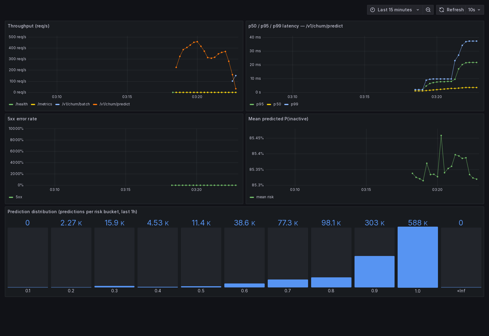
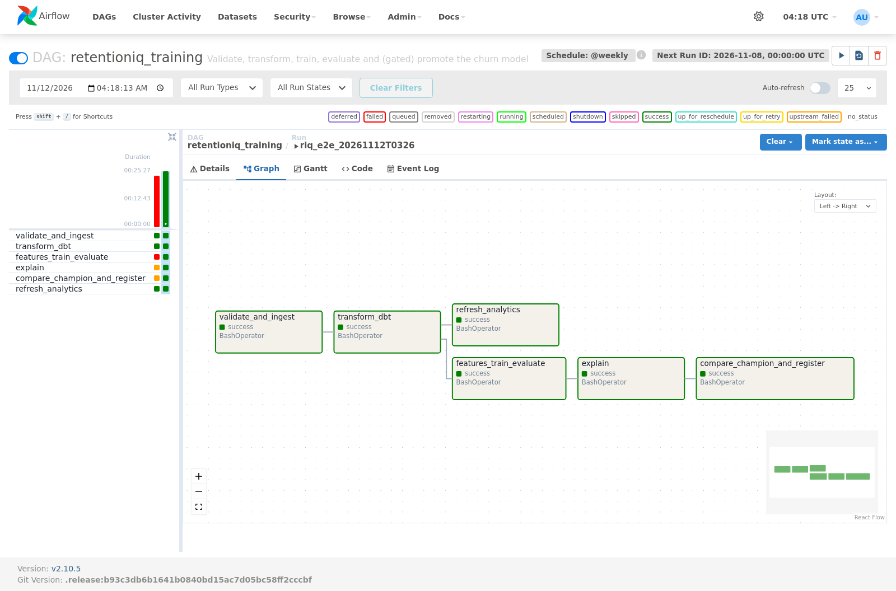
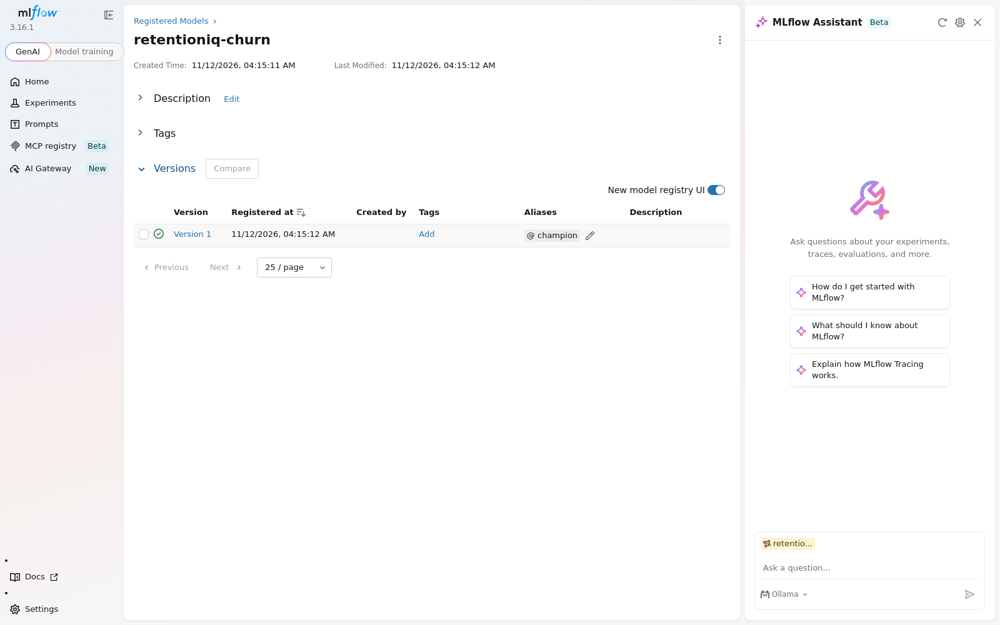

# Operations runs: Airflow, Prometheus and Grafana

Two runs of the stack defined in `docker-compose.yml`, made on 2026-11-12 (UTC) in a GitHub
Codespace (4 vCPU, `standardLinux32gb`). Everything below is copied from those runs; the
raw files sit next to this page.

## 1. Monitoring: API image + Prometheus + Grafana under load

`docker compose --profile serving --profile monitoring up -d --build api prometheus grafana`,
then `evaluation/benchmark_serving.py` against the container (load generator on the same
4 vCPUs).

| | |
|---|---|
| Containers | `retentioniq-api` (2 Uvicorn workers), `prom/prometheus:v3.1.0`, `grafana/grafana:11.4.0`, `postgres:16` ([compose_ps.txt](monitoring/compose_ps.txt)) |
| Scrape target | `http://api:8000/metrics`, health `up`, no scrape errors ([prom_targets.json](monitoring/prom_targets.json)) |
| Alert rules | 5 loaded from `monitoring/prometheus/alerts.yml`, all healthy and inactive ([prom_rules.json](monitoring/prom_rules.json), [screenshot](monitoring/prometheus_alerts.png)) |
| Grafana | Dashboard and Prometheus datasource provisioned from files; Grafana queries Prometheus through its own datasource proxy ([grafana_proxy_query.json](monitoring/grafana_proxy_query.json)) |
| Counter resets across 2 workers | 0 on every series ([q_counter_resets.json](monitoring/q_counter_resets.json)) |

First load run (5 scenarios × 150 s, [serving_benchmark_docker.json](monitoring/serving_benchmark_docker.json)):

| Scenario | Requests | req/s | p50 ms | p95 ms | p99 ms | 5xx |
|---|---:|---:|---:|---:|---:|---:|
| `/v1/churn/predict?explain=false`, c=1 | 57,759 | 385.1 | 2.53 | 3.02 | 3.75 | 0 |
| `/v1/churn/predict?explain=false`, c=8 | 69,520 | 463.4 | 12.44 | 43.75 | 74.37 | 0 |
| `/v1/churn/predict?explain=false`, c=32 | 45,584 | 303.8 | 67.03 | 318.85 | 503.91 | 0 |
| `/v1/churn/predict` (with SHAP), c=8 | 46,250 | 308.3 | 24.96 | 39.26 | 47.99 | 0 |
| `/v1/churn/batch` (100 rows), c=4 | 27,391 | 182.6 | 21.45 | 28.08 | 32.72 | 0 |

The c=8 single-record scenario passes every §9.2 SLO (p50 ≤ 25 ms, p95 ≤ 100 ms,
p99 ≤ 250 ms, errors ≤ 0.1 %, ≥ 200 req/s). Prometheus, scraping every 15 s, saw the same
traffic: 219,193 single predictions and 27,396 batch requests, peak 467 req/s on
`/v1/churn/predict` (1-min rate), no 5xx.

The screenshot is from a shorter second run (60 s scenarios) after the panel fixes below, on a
fresh Prometheus.

### Bugs found by running it

1. **Metrics from two workers were not aggregated.** The image runs 2 Uvicorn workers; each
   kept its own counters, so a scrape saw whichever worker answered. Fixed with
   `PROMETHEUS_MULTIPROC_DIR` in the image and a `MultiProcessCollector` in `/metrics`,
   covered by `test_metrics_aggregate_across_worker_processes`.
2. **"5xx error rate" showed "No data" on a healthy service**, because no 5xx series exists
   before the first error. It now reads 0 (`or vector(0)`).
3. **"Prediction distribution" plotted cumulative bucket counts as time series**, with labels
   such as `0.30000000000000004`. It is now a per-bucket bar gauge and the bucket bounds are
   rounded.

Remaining cosmetic issue: with an all-zero series Grafana still auto-scales the 5xx axis.

## 2. Airflow: `retentioniq_training` end to end on an empty database

`docker compose down -v` (Postgres and MLflow volumes deleted), then
`docker compose --profile orchestration up -d --build postgres mlflow airflow`,
`airflow dags unpause` and `airflow dags trigger`.

Unpausing also started the latest scheduled interval (`scheduled__2026-11-01`), which ran
first because `max_active_runs=1`:

| Run | Result |
|---|---|
| `scheduled__2026-11-01` | `validate_and_ingest` loaded the empty warehouse: 38,080,635 rows from 6 files, 0 rejected, in 15.9 min; `transform_dbt` passed. `features_train_evaluate` then failed (MLflow bug below), so `explain` and `compare_champion_and_register` were `upstream_failed` and nothing was promoted ([log](airflow/logs/scheduled__2026-11-01T00:00:00+00:00__validate_and_ingest__attempt1.log)) |
| `riq_e2e_20261112T0326` | **success**, every task ([task_states.json](airflow/task_states.json), [dag_runs.json](airflow/dag_runs.json)) |

Tasks of the successful run:

| Task | Duration | Result |
|---|---:|---|
| `validate_and_ingest` | 0.1 min | Every file skipped by the checksum ledger (unchanged since the load above) |
| `transform_dbt` | 1.2 min | 75 nodes: PASS 74, WARN 1, ERROR 0. The warning is the warn-severity test on one online-retail row with quantity 0 |
| `refresh_analytics` | 1.9 min | Customer intelligence + survival |
| `features_train_evaluate` | 17.9 min | Attempt 1 failed (MLflow bug). The compose fix was applied and MLflow restarted before the automatic retry; attempt 2 succeeded. Six-model ladder logged to MLflow |
| `explain` | 0.1 min | SHAP |
| `compare_champion_and_register` | 0.4 min | All 6 promotion gates passed; `M4_lightgbm` registered as `retentioniq-churn` v1, alias `champion` ([promotion_decision.json](airflow/promotion_decision.json), [mlflow_registered_models.json](airflow/mlflow_registered_models.json)) |

### Reproducibility

The DAG retrained from raw downloads in a fresh database. Against the published v0.6.4 run,
`churn_test_predictions.parquet`, `churn_segment_metrics.csv`, `churn_threshold_scenarios.csv`,
`shap_global.csv`, `feature_ablation.csv`, `churn_sensitivity.csv`, `survival_summary.json`
and `survival_cox_coefficients.csv` are byte-identical (SHA-256). The promotion gate compared
the new champion with production and found a PR-AUC delta CI of [0, 0] and identical Brier
(0.09331). Files that differ: the measured latencies (M3 random forest p95 79.2 ms against
60.8 ms; ineligible either way) and float noise of ≤ 6e-16 in the random-forest validation
predictions.

### Bug found by running it

**MLflow 3 rejected the Airflow container.** The tracking server only accepts `localhost` and
private-IP Host headers by default (DNS-rebinding guard), so requests to `http://mlflow:5000`
got `403 Invalid Host header`. Fixed with `--allowed-hosts` in `docker-compose.yml`. Two
compose fixes were also needed for the run: Airflow runs as the host UID so tasks can write
the bind-mounted repo, and receives the Kaggle credentials its download task needs.

## Not covered

- Alertmanager is not configured: the rules evaluate in Prometheus, but no notification is routed.
- No alert was driven to `firing`; the run shows rules loaded and inactive under normal load.
- Terraform for AWS has still not been applied.
